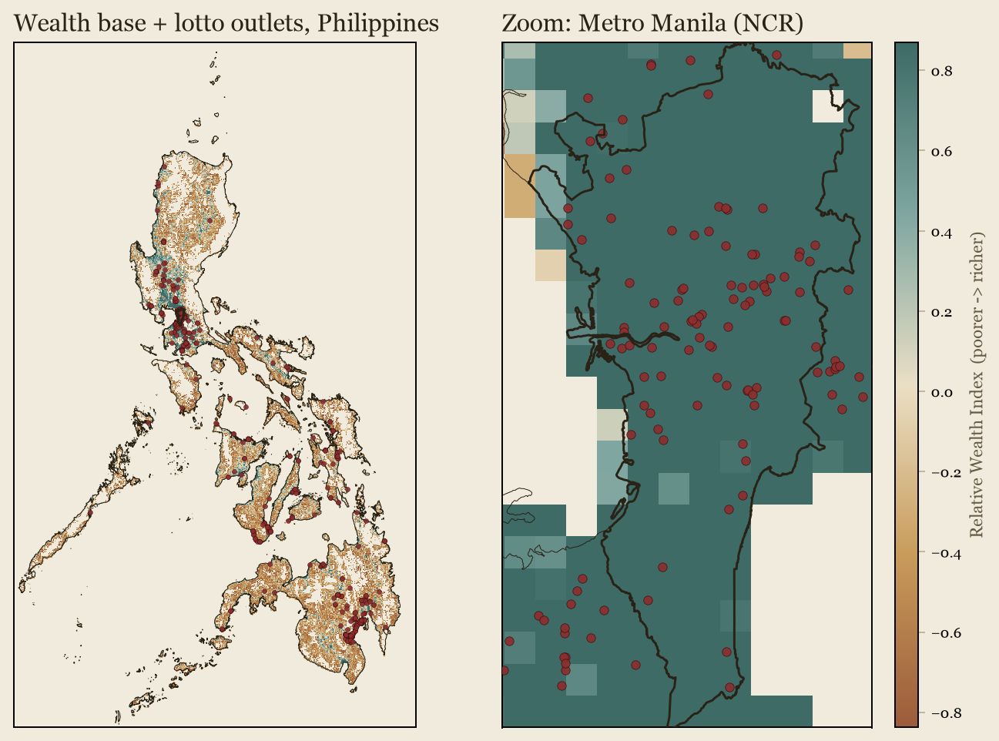
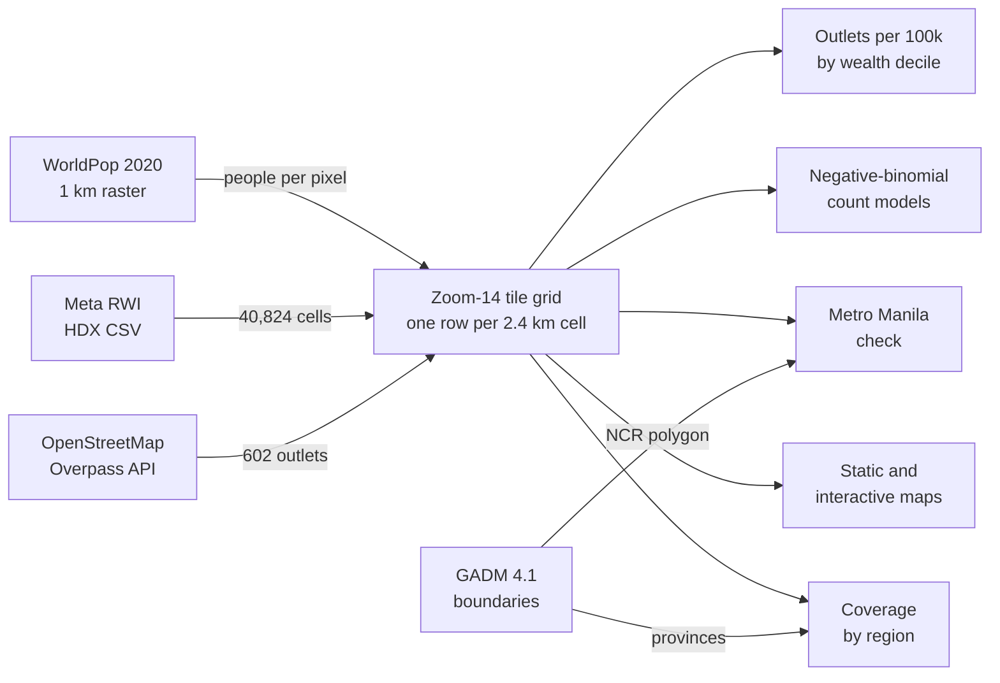
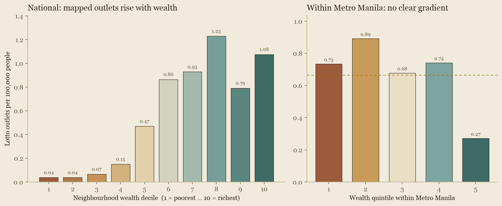
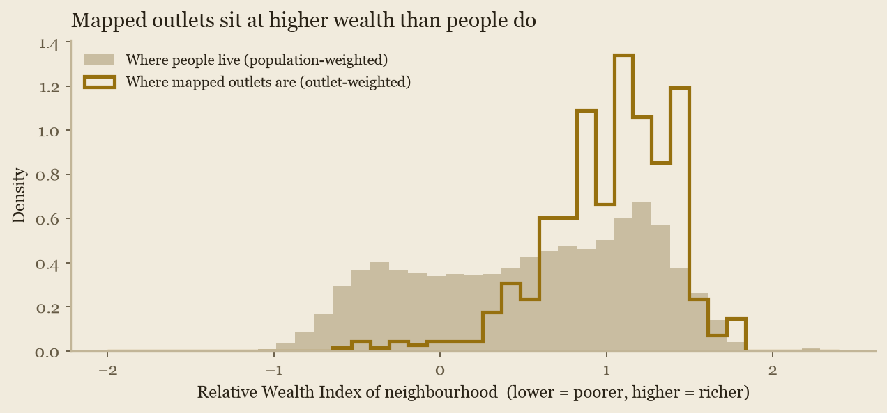

# Lottery as a tax on the poor? A spatial test for the Philippines

Earl Yu.
Open data only.
Outlets pulled from OpenStreetMap on 23 October 2026.

**Abstract.**
Do lottery outlets in the Philippines cluster in poorer neighbourhoods?
On the best open data, no.
Per person, mapped outlets are more common in richer places: the richer half of the population has 6.4 times the mapped-outlet density of the poorer half, and each one standard deviation rise in neighbourhood wealth goes with 2.2 times the outlet rate (95% CI 2.0-2.4).
The biggest caveat is the data itself.
The open record holds 397 lotto outlets, about 9% of the roughly 4,600 the Philippine Charity Sweepstakes Office (PCSO) reports, plus 205 Small Town Lottery points, 176 of them in one region.
Its gaps run the same way as the finding: richer, more urban regions are better mapped, so the national gradient may be mostly a mapping artefact.
Inside Metro Manila, where urbanicity and mapping are roughly constant, there is no clear gradient (rate ratio 0.79, 95% CI 0.57-1.09).
The study measures where tickets are sold, not who buys them, so it says little about the spending claim at the heart of "a tax on the poor".
That needs household budget data.



*Map 1. Left: the national wealth grid (terracotta = poorer, teal = richer) with every mapped lotto outlet. Right: Metro Manila, which is wealthy by national standards almost everywhere.
The interactive version is [`maps/lottery_map.html`](maps/lottery_map.html): download it and open it in any browser to pan, zoom and click outlets.*

## Contents

1. [Background and objectives](#1-background-and-objectives)
2. [Research questions](#2-research-questions)
3. [Data sources](#3-data-sources)
4. [Implementation](#4-implementation)
5. [Analysis](#5-analysis)
6. [Discussion](#6-discussion)
7. [References](#references)
8. [How to reproduce](#how-to-reproduce)

## 1. Background and objectives

This project started with Johnny Harris's video [*The US Lottery is a Lie*](https://www.youtube.com/watch?v=3Yn_3HqfV1w) (YouTube, 8 March 2023) [17].
It asks why US state governments run lotteries and where the money comes from, and makes the case that lottery revenue leans on lower-income players.
That is the familiar charge that the lottery is "a tax on the poor".
This paper asks whether the same story can be seen on a map of the Philippines, using only data anyone can download.

The Philippine lottery is a state enterprise, and a large one.
The PCSO runs Lotto, the Small Town Lottery (STL) and the sweepstakes.

| Measure | Value | Source |
|---|---|---|
| PCSO gaming revenue, 2023 | PHP 61.45 billion (about US$1.1 billion), up 7% on 2022 | Philstar [1] |
| PCSO gaming revenue, 2024 | PHP 62.35 billion, of which STL PHP 31.76 billion and Lotto with digit games PHP 29.72 billion | PCSO 2024 year-end report [2] |
| Price of a standard lotto play | PHP 20, rolled back from PHP 24 in 2020 | Philstar [3] |
| Authorised lotto outlets | about 4,600 (October 2023), plus a separate STL network | Philstar [4] |
| For scale | more lotto outlets than 7-Eleven stores (about 4,000) and about 3.5 times the number of Jollibee branches (about 1,300) | Inquirer [5], Statista [6] |

The outlet comparisons are approximate and move year to year.
Against the 109.6 million people in the population layer used here, 4,600 outlets is about 4.2 per 100,000 people, or one for every 24,000.
The terminals and draw system are leased from private firms: in 2021 a joint venture of Pacific Online Systems, Philippine Gaming Management Corporation and International Lottery & Totalizator Systems won a five-year, PHP 5.8 billion nationwide lease [7].

What sharpens the question is where the money goes, because that is set by statute.
The sweepstakes date back to Act No. 4130 of 1934, and the PCSO's charter is Republic Act 1169 of 1954 [8].
Section 6 of the charter, as amended by Batas Pambansa Blg. 42 in 1979, splits net receipts 55% to prizes, 30% to a charity fund for "health programs, medical assistance and services and/or charities of national character", and 15% to operations [9].
The Universal Health Care Act (Republic Act 11223, 2019) then directs 40% of that charity fund to PhilHealth [10].
In a single month the charity fund can cover tens of thousands of patients' medical bills [11].
The STL exists as a legal alternative to *jueteng*, the illegal numbers game penalised under Presidential Decree 1602 as amended by Republic Act 9287 [12].
So a PHP 20 bet funds hospital bills by law, and it matters whose PHP 20 it is.

"A tax on the poor" bundles two claims.
The **access claim** is that outlets are concentrated in poorer neighbourhoods, which a map can test.
The **spending claim** is that poorer households spend a larger share of income on tickets, which only household budget data can test.

**Objective.**
Test the access claim with open data, at the finest spatial grain the data allow, controlling for population, and be explicit about what the result can and cannot say about the spending claim.

## 2. Research questions

1. **RQ1.** After accounting for population, are mapped lotto outlets more common per person in poorer neighbourhoods than in richer ones?
   The access version of "a tax on the poor" predicts a negative relationship between outlets per person and wealth.
2. **RQ2.** Does any wealth gradient survive once urbanicity, measured as population density, is held constant?
3. **RQ3.** Does the gradient hold inside Metro Manila, where urbanicity and mapping coverage are roughly constant across neighbourhoods?
4. **RQ4.** How complete is the open outlet record, and in which direction would its gaps bias RQ1 to RQ3?

## 3. Data sources

All four layers are public, free and need no account or API key.

| Layer | Source | Link | Licence | Granularity | Vintage |
|---|---|---|---|---|---|
| Lottery outlets | OpenStreetMap, via the Overpass API | [overpass-api.de](https://overpass-api.de/) | ODbL 1.0 | Points | Pulled 23 Oct 2026 |
| Neighbourhood wealth | Meta / Data for Good Relative Wealth Index (RWI) [13] | [HDX](https://data.humdata.org/dataset/relative-wealth-index) | CC BY-NC 4.0 | About 2.4 km grid, 40,824 cells | 2021 |
| Population | WorldPop UN-adjusted population count | [WorldPop](https://hub.worldpop.org/geodata/summary?id=49730) | CC BY 4.0 | 1 km raster | 2020 |
| Boundaries | GADM 4.1 | [gadm.org](https://gadm.org/download_country.html) | Free for non-commercial use, no redistribution | Province to municipality | 2022 |

**Outlets.**
OpenStreetMap is the only open, nationwide, point-level list of lottery outlets.
The Overpass query returned 632 elements; after keeping only genuine lottery outlets, 602 remain.
Of these, 586 are tagged `shop=lottery` and 238 name the PCSO as operator.
397 are lotto outlets and 205 are named as Small Town Lottery points; the analysis uses all 602, with a lotto-only check in [3.1](#31-the-outlet-coverage-gap).
All 602 fall inside an RWI cell.
This is a sample, not a census, and how far it falls short is the main limit on everything that follows ([3.1](#31-the-outlet-coverage-gap)).
The first run of this study, on 23 September 2026, found 591 outlets; the extra 11 moved the headline numbers by less than 10% and changed no conclusion.

**Wealth.**
The RWI is the only open wealth measure that is both nationwide and finer than a city.
It is a modelled, relative score built from satellite imagery, mobile network data, topographic maps and aggregated Facebook connectivity data, calibrated to household surveys [13].
A score near zero is about the national average; it is not income in pesos and not a poverty rate.

**Population.**
WorldPop's 1 km count sums to 109.6 million, consistent with the 2020 census.
It turns outlet counts into a per-person rate, which is the only fair way to compare a crowded city block with a rural barangay.

**Boundaries.**
GADM supplies the province polygons for the regional coverage table, the Metro Manila (National Capital Region) polygon for the robustness check, and the coastline for the static map.
Its finest Philippine level is the city or municipality, which is why the RWI grid, not an administrative choropleth, is the base layer.

### 3.1 The outlet coverage gap

The PCSO reported about 4,600 authorised lotto outlets in October 2023 [4].
OpenStreetMap has **397** of them, about **9%**: 0.36 mapped lotto outlets per 100,000 people against about 4.2 authorised.
The Small Town Lottery is a separate network, which took PHP 31.76 billion in 2024, more than Lotto [2].
OpenStreetMap has 205 points named as STL, and 176 of them are in Davao region, so STL coverage is in effect one region's mapping.
This study uses the OpenStreetMap outlets as they are; it does not add other outlet sources.

The gap is not spread evenly.
Rolling the grid up to the 17 administrative regions (as they stood before the 2024 Negros Island Region) shows how uneven the record is.

| Region | Share of people | Share of mapped lotto outlets | Lotto outlets per 100k | STL points | Mean RWI |
|---|---:|---:|---:|---:|---:|
| NCR (Metro Manila) | 12.0% | 20.7% | 0.64 | 1 | 1.31 |
| IV-A Calabarzon | 14.9% | 20.9% | 0.52 | 2 | 0.89 |
| III Central Luzon | 11.2% | 10.6% | 0.35 | 3 | 0.67 |
| VII Central Visayas | 7.8% | 14.4% | 0.68 | 1 | 0.54 |
| XI Davao | 5.2% | 6.8% | 0.49 | 176 | 0.47 |
| I Ilocos | 5.1% | 1.8% | 0.13 | 0 | 0.45 |
| X Northern Mindanao | 5.2% | 3.5% | 0.25 | 14 | 0.34 |
| VI Western Visayas | 7.4% | 4.0% | 0.20 | 1 | 0.31 |
| CAR | 1.8% | 1.5% | 0.32 | 0 | 0.28 |
| XIII Caraga | 2.6% | 1.8% | 0.26 | 0 | 0.21 |
| V Bicol | 6.0% | 1.8% | 0.11 | 0 | 0.19 |
| IX Zamboanga Peninsula | 3.6% | 1.8% | 0.18 | 1 | 0.18 |
| VIII Eastern Visayas | 4.2% | 8.8% | 0.78 | 1 | 0.17 |
| II Cagayan Valley | 3.5% | 0.3% | 0.03 | 0 | 0.14 |
| BARMM | 2.2% | 0.0% | 0.00 | 0 | 0.13 |
| XII Soccsksargen | 4.5% | 0.3% | 0.02 | 3 | 0.11 |
| Mimaropa | 2.9% | 1.3% | 0.16 | 2 | 0.06 |

Regions sorted from richest to poorest by population-weighted RWI.
Source: [`data/derived/outlets_by_region.csv`](data/derived/outlets_by_region.csv), from [`src/coverage.py`](src/coverage.py).

Richer regions have more mapped lotto outlets per person (rank correlation across the 17 regions +0.67, p = 0.003).
Metro Manila and Calabarzon hold 27% of people and 42% of mapped lotto outlets; Cagayan Valley, Soccsksargen and BARMM hold 10% of people and 2 outlets between them.
With open data alone there is no way to tell how much of that is real outlet density and how much is mapping effort, but a more than 30-fold spread in mapped lotto outlets per person between regions with any outlets at all is far more than retail geography would explain.

What matters for the research questions (RQ4) is the direction.
The gaps are largest in poorer, more rural regions, which is the same direction as the national finding.
So the national gradient in [section 5](#5-analysis) may be mostly a mapping artefact.
Dropping the STL points does not remove it: on lotto outlets alone the national wealth rate ratio is 2.43 per standard deviation (95% CI 2.16-2.73; [`data/derived/coverage.json`](data/derived/coverage.json)), so the gradient does not come from Davao's STL mapping but from the urban, richer tilt of the whole record.

### 3.2 Choosing a wealth measure

Every Philippine wealth or poverty measure trades truth against spatial fineness.

| Indicator | Measures | Finest open level | Open? |
|---|---|---|---|
| **Meta RWI (used here)** | Relative wealth, modelled | About 2.4 km grid | Yes |
| PSA Small Area Estimates, 2021 [14] | Poverty incidence (%) | City or municipality | Yes |
| Family Income and Expenditure Survey (FIES) | Household income and spending | Province or highly urbanised city | Yes, aggregated |
| Demographic and Health Survey (DHS) | Asset-based wealth index | Survey cluster, location displaced | Yes, on registration |
| Community-Based Monitoring System (RA 11315) [15] | Household poverty | Barangay | No, held by local governments |
| VIIRS night-time lights | Economic activity proxy | About 500 m | Yes |

A true barangay poverty rate exists (CBMS) but is not public.
The finest open poverty rate is municipal, which is too coarse to separate rich and poor neighbourhoods within a city.
So this study keeps the RWI for its fineness and states plainly that it measures relative wealth, not poverty.

## 4. Implementation

### 4.1 Pipeline



| Step | Script | Writes |
|---|---|---|
| Download the four layers | [`src/fetch_data.sh`](src/fetch_data.sh) | `data/raw/` (gitignored) |
| Build the grid, run the decile test and count models | [`src/analysis.py`](src/analysis.py) | [`data/derived/`](data/derived/) decile table, headline numbers, outlet list |
| Metro Manila check | [`src/robustness.py`](src/robustness.py) | [`data/derived/`](data/derived/) quintile table and model |
| Outlet coverage by region | [`src/coverage.py`](src/coverage.py) | [`data/derived/`](data/derived/) region table, model without Davao |
| Charts | [`src/viz.py`](src/viz.py) | [`figures/`](figures/) |
| Static map | [`src/mapfig.py`](src/mapfig.py) | [`figures/fig_map_static.png`](figures/fig_map_static.png) |
| Interactive map | [`src/map.py`](src/map.py) | [`maps/lottery_map.html`](maps/lottery_map.html) |

### 4.2 One shared grid

The four layers come in four shapes: points, a grid of wealth scores, a raster of population and administrative polygons.
Rather than join them with spatial overlays, every layer is put on one grid: the standard web-map tile grid at zoom level 14.
At Philippine latitudes those tiles are about 2.4 km across, and they are exactly the cells the RWI was published on.

Each RWI score, each populated 1 km population pixel (by its centre) and each outlet is converted to the tile it falls in, and then grouped by tile.
The result is one row per cell with three numbers: wealth, population and outlet count.
No spatial-join library is needed for this step, only integer tile keys, which makes it fast and easy to check.
The 40,726 cells with people in them hold 106.4 million of the 109.6 million people in the raster; the rest live in tiles the RWI does not cover.

### 4.3 Pulling outlets from OpenStreetMap

The outlets come from OpenStreetMap through the Overpass API, a public read-only query service.
The query asks for every node, way and relation in the Philippines tagged as a lottery shop, carrying a `lottery` tag, tagged as a bookmaker, or a shop whose name mentions lotto, PCSO or lottery.
Overpass returns each match with its tags and a point location (the centre, for buildings drawn as shapes).
[`src/analysis.py`](src/analysis.py) then keeps only genuine lotto outlets: `shop=lottery`, `lottery=yes`, or a name containing lotto, PCSO, sweepstakes or STL.
Overpass rejects requests without a `User-Agent` header (HTTP 406), so the fetch script always sends one.

<details>
<summary>The Overpass query (<code>src/overpass_query.ql</code>)</summary>

```
[out:json][timeout:240];
area["ISO3166-1"="PH"][admin_level=2]->.ph;
(
  nwr["shop"="lottery"](area.ph);
  nwr["lottery"](area.ph);
  nwr["shop"="bookmaker"](area.ph);
  nwr["name"~"lotto|PCSO|Lottery",i]["shop"](area.ph);
);
out center tags;
```

You can paste it into [overpass-turbo.eu](https://overpass-turbo.eu/) to see the outlets on a map.
</details>

OpenStreetMap changes every day, so the cleaned outlet list used for this paper is committed as [`data/derived/outlets_clean.csv`](data/derived/outlets_clean.csv) (ODbL, © OpenStreetMap contributors).

### 4.4 Running it

`./run_all.sh` builds a local virtual environment, installs the pinned [`requirements.txt`](requirements.txt), downloads the data and runs every step; see [How to reproduce](#how-to-reproduce).
On the same downloaded data a re-run writes byte-identical figures, tables and maps.
Step-by-step guides for rebuilding the map by hand are in [`docs/qgis-guide.md`](docs/qgis-guide.md) (QGIS, no code) and [`docs/python-webmap-guide.md`](docs/python-webmap-guide.md) (Python and Folium).

## 5. Analysis

### 5.1 Outlets per person by wealth decile

Cells are sorted by wealth and cut into ten bins of equal population, so each decile is a tenth of the people in the grid (about 10.6 million), not a tenth of the cells.

| Decile | Cells | Mean RWI | Population | Outlets | Outlets per 100k |
|---:|---:|---:|---:|---:|---:|
| 1 (poorest) | 14,515 | -0.65 | 10,641,002 | 4 | 0.04 |
| 2 | 9,952 | -0.33 | 10,642,407 | 4 | 0.04 |
| 3 | 6,677 | -0.05 | 10,641,937 | 7 | 0.07 |
| 4 | 3,931 | 0.24 | 10,641,997 | 16 | 0.15 |
| 5 | 2,442 | 0.51 | 10,641,771 | 50 | 0.47 |
| 6 | 1,465 | 0.74 | 10,641,014 | 92 | 0.86 |
| 7 | 837 | 0.94 | 10,448,351 | 97 | 0.93 |
| 8 | 470 | 1.13 | 10,811,541 | 133 | 1.23 |
| 9 | 248 | 1.29 | 10,623,955 | 84 | 0.79 |
| 10 (richest) | 189 | 1.52 | 10,688,305 | 115 | 1.08 |

Source: [`data/derived/decile_table.csv`](data/derived/decile_table.csv).

Mapped outlets per person rise with wealth, steeply up to the eighth decile and then level off.
The poorer half of the population has 0.15 mapped outlets per 100,000 people and the richer half 0.98, a ratio of 6.4.
The rank correlation between decile and rate is +0.89 (p = 0.0005), though with only ten binned points it describes the shape rather than adding precision.
The bottom four deciles together hold 31 outlets, so their rates rest on very small counts.

The `Cells` column is the clue to what is going on.
The poorest tenth of people are spread over 14,515 cells; the richest tenth live in 189.
Wealth in the Philippines is concentrated in a few dense urban areas, and so are shops of every kind.



*Figure 1. Left: mapped outlets per 100,000 people by national wealth decile. Right: the same rate by wealth quintile inside Metro Manila; the dashed line is the Metro Manila average.*

### 5.2 Where outlets sit compared with where people live



*Figure 2. The wealth of the neighbourhoods people live in (filled, weighted by population) against the wealth of the neighbourhoods mapped outlets are in (gold line).*

People are spread across the whole wealth range, from about -1 to 1.5; mapped outlets bunch between about 0.6 and 1.5.
The poorest three deciles hold 30% of people but 15 of the 602 mapped outlets (2.5%).

### 5.3 Count models

A decile table can hide confounders, so the same question is put to a count model.
The model predicts how many outlets a cell has from its wealth, with the cell's population built in as an exposure, so the coefficient describes outlets per person.
A negative-binomial model is used because outlet counts are mostly zero (99.2% of cells have none) and very uneven; its dispersion is fixed at 1.
Wealth is standardised, so each result is a rate ratio: how many times the outlet rate multiplies for a one standard deviation richer cell.
The models use the 40,170 cells with at least 50 people, to avoid unstable tiny denominators.

| Model | Term | Rate ratio | 95% CI |
|---|---|---:|---:|
| 1. Wealth only | Wealth (+1 SD) | 2.20 | 2.01-2.41 |
| 2. Wealth and density | Wealth (+1 SD) | 3.19 | 2.78-3.65 |
| 2. Wealth and density | Population density (+1 SD of log) | 0.63 | 0.56-0.71 |

Source: [`data/derived/headline.json`](data/derived/headline.json).

**Model 1** says a cell one standard deviation richer has about 2.2 times the mapped-outlet rate, with a confidence interval well clear of 1 (RQ1).
On the 397 lotto outlets alone, leaving out the STL points, the ratio is 2.43 (95% CI 2.16-2.73).
**Model 2** adds population density.
The wealth ratio grows to 3.2 and density turns negative: among places of equal wealth, the denser one has fewer mapped outlets per person (RQ2).
So the gradient is not simply "more people, more shops".
It tracks wealth, and, as the next section shows, the places that are both wealthy and well mapped.
The p-values are tiny (below 10^-60) because there are 40,000 cells; the intervals are the better guide to precision, and they assume the fixed dispersion is right.

### 5.4 Robustness: inside Metro Manila

The national gradient could come from differences between regions: urban, well-mapped, wealthier places against rural, under-mapped, poorer ones.
Metro Manila is uniformly urban and among the best-mapped parts of the country, so testing within it holds both roughly constant (RQ3).

The region has 101 populated cells, 12.3 million people and 81 mapped outlets, cut here into five equal-population wealth quintiles.

| Quintile | Cells | Mean RWI | Population | Outlets | Outlets per 100k |
|---:|---:|---:|---:|---:|---:|
| 1 (poorest in NCR) | 23 | 0.94 | 2,451,525 | 18 | 0.73 |
| 2 | 22 | 1.18 | 2,354,255 | 21 | 0.89 |
| 3 | 21 | 1.30 | 2,508,901 | 17 | 0.68 |
| 4 | 19 | 1.44 | 2,428,899 | 18 | 0.74 |
| 5 (richest in NCR) | 16 | 1.65 | 2,580,075 | 7 | 0.27 |

Source: [`data/derived/ncr_quintiles.csv`](data/derived/ncr_quintiles.csv).

The rate is flat across the first four quintiles and lowest in the richest.
The count model gives a rate ratio of 0.79 per standard deviation of wealth (95% CI 0.57-1.09, p = 0.16): no detectable gradient, and the interval allows anything from a moderate negative to a slight positive one.
The rank correlation across the five quintiles is -0.50 (p = 0.39); with five points it is too coarse to lean on, and it is sensitive to how three tied wealth scores are split between quintiles (the September run, which broke ties differently, gave -0.80).

Two caveats bound this check.
Metro Manila's poorest quintile has a mean RWI of 0.94, around the national seventh decile, so the check compares middle-class with rich neighbourhoods, not poor with rich.
And 81 outlets is a small sample.
What it does show is that once urbanicity and mapping quality are held roughly constant, the strong national gradient does not reappear.

## 6. Discussion

### 6.1 What the map shows, and what it does not

The access version of "a tax on the poor" predicts more outlets per person in poorer neighbourhoods.
The open data show the opposite nationally and nothing clear within Metro Manila.
There is no evidence here that lotto outlets are packed into the poorest neighbourhoods.

The national pattern should not be read as "outlets target the rich" either.
Three forces produce it.
**Urbanicity:** outlets are retail, and retail sits in town centres, markets and transport hubs, which are wealthier on average than the barangays around them.
**Coverage:** OpenStreetMap is mapped by volunteers, who map cities and richer areas more completely, so outlets in poor rural areas are more likely to be missing from the data (RQ4, [3.1](#31-the-outlet-coverage-gap)).
**Geography of wealth:** the richest tenth of Filipinos live in 189 grid cells, so any shop type that clusters in cities will look "rich".

Put plainly: the coverage gap is biased the same way as the national finding, so the national gradient may be mostly a mapping artefact.
The record covers about 9% of authorised lotto outlets and STL points in only a couple of regions, and what it misses is concentrated in poorer regions.
That bias cannot rescue the "tax on the poor" reading either: correcting it would flatten the gradient, not reverse it on its own.
With this data we cannot say whether the true gradient is flat, mildly negative or still positive.

### 6.2 Why outlet location is the wrong instrument for the spending claim

The claim most people mean is about wallets, not shopfronts: that poorer households spend a larger share of their income on tickets.
Outlet location cannot test that, for two reasons.

First, where a kiosk sits is not where its buyers live.
An outlet in a Makati transport hub sells to commuters from poorer suburbs; a sari-sari store with a terminal serves its whole catchment.
Second, even a perfect count of outlets says nothing about how much each buyer spends relative to income.
A neighbourhood with few outlets can still spend a large share of its income on tickets, and one with many can spend little.

So this study can reject a strong access claim, but it leaves the spending claim open.
The case made in the video that motivated this project [17] is about spending, and nothing here contradicts it for the Philippines.

### 6.3 Limitations

- **Coverage bias.** 397 mapped lotto outlets against roughly 4,600 authorised is about 9% coverage, skewed to cities and wealthier regions, with no open register to check it against ([3.1](#31-the-outlet-coverage-gap)). This inflates the national gradient. The STL network, which takes more money than Lotto, is mapped almost only in Davao.
- **Ecological fallacy.** The unit is the neighbourhood, not the person. Outlet location is not buyer residence.
- **Modifiable areal unit problem.** Results are computed on a 2.4 km grid. A different cell size or an administrative choropleth could change the magnitudes, though the direction agrees across the decile table and the count models.
- **RWI is a relative proxy.** It is a modelled 2021 score with per-cell error, not measured income or poverty, and it ranks places within the country only.
- **Population confound.** Controlling for headcount and density does not separate wealth from everything else that comes with urban retail, such as transit, zoning and tourism.
- **Model choices.** The count models fix dispersion at 1 rather than estimating it, and the Metro Manila quintile rates move when tied wealth scores are split differently. The confidence intervals are conditional on those choices.

### 6.4 What would answer the question properly

- **For the spending claim:** the PSA Family Income and Expenditure Survey records household spending by category and income decile. The share of income spent on gambling by decile is the direct test of regressivity.
- **For the access claim:** a complete outlet list, which is what the next steps below go after.
- **For a finer wealth measure:** barangay poverty rates from the Community-Based Monitoring System, if local governments released them, or PSA municipal poverty estimates as a coarser cross-check.

### 6.5 Next steps: closing the outlet gap

This first pass deliberately uses only the OpenStreetMap outlets.
The sources to revisit, roughly in order of effort:

- **Overture Maps Places** [18]. An open places dataset assembled from Meta, Microsoft, Foursquare and others. Licences are per record (CDLA Permissive 2.0, or Apache 2.0 for Foursquare-sourced places). Check first whether its categories separate lotto outlets from general shops.
- **Foursquare Open Source Places** [19]. Released under Apache 2.0 and also folded into Overture. Same category question.
- **PCSO's own outlet listings.** Any outlet or agent lists the PCSO publishes, which would also show whether STL agents can be located at all.
- **An eFOI request to the PCSO** for the authorised outlet list with addresses, through the Philippine Freedom of Information portal. Similar requests have been filed before [16]; a released list would let the analysis run on a census instead of a sample, and would show how biased the OpenStreetMap record is.

Any new source should be checked against the regional table in [3.1](#31-the-outlet-coverage-gap) before it goes into the models.

## References

1. Philstar. "PCSO earns P61.45 billion in 2023." 22 April 2024. <https://www.philstar.com/nation/2024/04/22/2349455/pcso-earns-p6145-billion-2023>
2. Philippine Charity Sweepstakes Office. *Accomplishment Report 2024, Year-end.* 26 February 2025. <https://pcso-gov.ph/pcsofiles/transparency/12/Accomplishment%20Report%202024%20Yearend%20(20250226).pdf>
3. Philstar. "PCSO rolls back lotto ticket price." 8 June 2020. <https://www.philstar.com/headlines/2020/06/08/2019414/headlines>
4. Philstar. "PCSO to push for more lotto outlets." 9 October 2023. <https://www.philstar.com/nation/2023/10/09/2302293/pcso-push-more-lotto-outlets>
5. Inquirer. "7-Eleven operator celebrates 4,000-store milestone in PH." <https://business.inquirer.net/485115/7-eleven-operator-celebrates-4000-store-milestone-in-ph>
6. Statista. "Number of Jollibee stores." <https://www.statista.com/statistics/1479196/number-of-jolibee-stores/>
7. BusinessWorld. "Pacific Online, partners bag lease for PCSO lottery system." 7 September 2021. <https://bworldonline.com/corporate/2021/09/07/394630/pacific-online-partners-bag-lease-for-pcso-lottery-system/>
8. Republic Act No. 1169 (1954), the PCSO Charter. LawPhil. <https://lawphil.net/statutes/repacts/ra1954/ra_1169_1954.html>
9. Batas Pambansa Blg. 42 (1979), amending RA 1169. LawPhil. <https://lawphil.net/statutes/bataspam/bp1979/bp_42_1979.html>
10. Republic Act No. 11223 (2019), Universal Health Care Act, Section 37(c). LawPhil. <https://lawphil.net/statutes/repacts/ra2019/ra_11223_2019.html>
11. GMA News. "PCSO: 37,186 patients benefit from medical assistance in May." <https://www.gmanetwork.com/news/money/companies/657405/pcso-37-186-patients-benefit-from-medical-assistance-in-may/story/>
12. Republic Act No. 9287 (2004), increasing penalties for illegal numbers games. Supreme Court E-Library. <https://elibrary.judiciary.gov.ph/thebookshelf/showdocs/2/1457>
13. Chi, G., Fang, H., Chatterjee, S. and Blumenstock, J. E. "Microestimates of wealth for all low- and middle-income countries." *PNAS* 119 (3), e2113658119, 2022. <https://doi.org/10.1073/pnas.2113658119>
14. Philippine Statistics Authority. "PSA releases the 2021 city and municipal level poverty estimates." <https://psa.gov.ph/content/psa-releases-2021-city-and-municipal-level-poverty-estimates>
15. Republic Act No. 11315 (2019), Community-Based Monitoring System Act. Official Gazette. <https://www.officialgazette.gov.ph/2019/04/17/republic-act-no-11315/>
16. eFOI Philippines. "List of lotto outlets in the Philippines as of December 31, 2023." <https://www.foi.gov.ph/requests/list-of-lotto-outlets-in-the-philippines-as-of-december-31-2023/>
17. Harris, J. *The US Lottery is a Lie.* YouTube, 8 March 2023. <https://www.youtube.com/watch?v=3Yn_3HqfV1w>
18. Overture Maps Foundation. "Places guide." <https://docs.overturemaps.org/guides/places>
19. Foursquare. "Foursquare Open Source Places." <https://opensource.foursquare.com/os-places/>

Data: © OpenStreetMap contributors (ODbL); Meta / Data for Good Relative Wealth Index via the Humanitarian Data Exchange (CC BY-NC 4.0); WorldPop, University of Southampton (CC BY 4.0); GADM 4.1.

## How to reproduce

Needs Python 3.12, `curl` and about 80 MB of downloads.
Nothing is installed globally.

```bash
git clone https://github.com/earlcyu-petcircle/ph-lottery-outlets.git
cd ph-lottery-outlets
./run_all.sh              # venv, pinned packages, downloads, analysis, figures, maps
./run_all.sh --refresh    # same, but pull a fresh OpenStreetMap snapshot
```

Set `PYTHON=/path/to/python3.12` if `python3.12` is not on your path.
A run reuses anything already in `data/raw/`, so on the same downloads it reproduces the committed outputs exactly.
A `--refresh` run picks up OpenStreetMap edits made since 23 October 2026, so expect the outlet count and the numbers to move slightly.

Code is MIT licensed (see [LICENSE](LICENSE)); the data keep their own licences, listed above.
