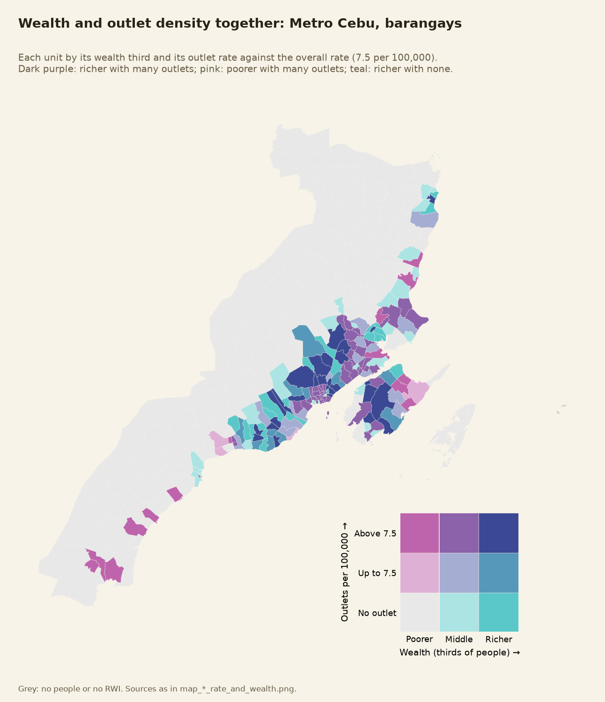
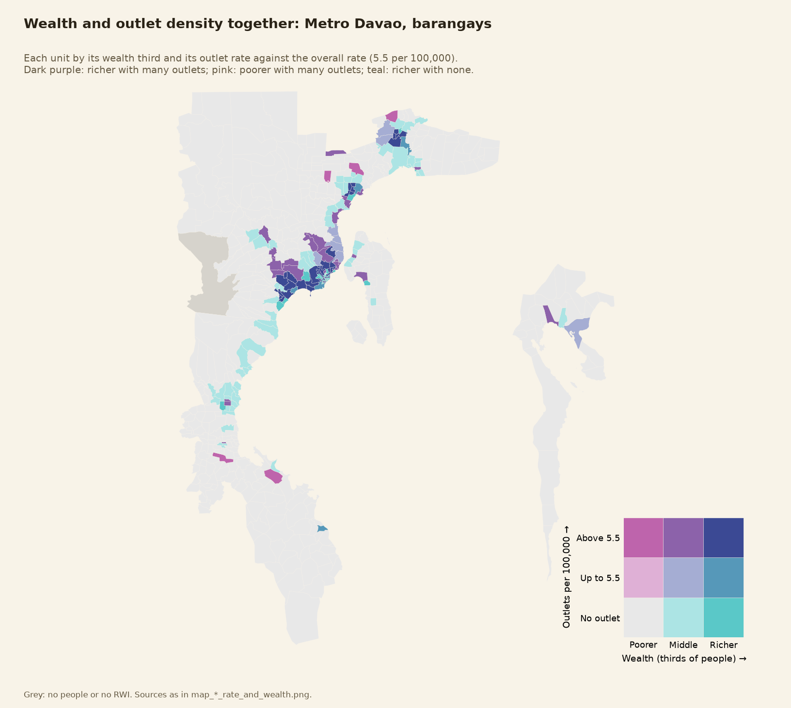

# Lottery as a tax on the poor? A spatial study of lotto outlets in the Philippines

Earl Yu.
Open and published data only.

**Status.**
The research design was settled on 31 October 2026, the data are collected, and the analysis has run (step 3 of 5).
This README sets out the question, the data and the planned analysis.
The model, distance and descriptive tables are in [`results/`](results/) and the interactive map in [`docs/map/`](docs/map/); the findings and discussion come in step 4.

| Step | Scope | Status |
|---|---|---|
| 1. Research design | Question, data sources, unit of analysis, models | Done (this README) |
| 2. Data collection | Fetch every source; place PCSO outlets; build one table per wealth tile and one per barangay; data-quality note | Done ([Data](#5-data)) |
| 3. Data analysis | Count and presence models, spatial checks, barangay check, within-city analysis (Metro Manila, Metro Cebu, Metro Davao), road distance, web map | Done ([`results/`](results/), [`docs/map/`](docs/map/)) |
| 4. Results and discussion | Findings, figures, maps, limitations | Next |
| 5. Clean-up | README as the finished paper; repo tidy | To do |

### Step 3 figures

The analysis notebooks are in [`notebooks/`](notebooks/) and the interactive map in [`docs/map/`](docs/map/); these figures can be read without either.

| Figure | What it shows |
|---|---|
| [`map_national_bivariate.png`](results/figures/map_national_bivariate.png) | Every 2.4 km wealth tile by wealth third and outlet rate together: the national relationship on one map |
| [`map_ncr_bivariate.png`](results/figures/map_ncr_bivariate.png) | The same for Metro Manila's barangays |
| [`map_national_rate_and_wealth.png`](results/figures/map_national_rate_and_wealth.png) | Outlets per 100,000 people beside the Relative Wealth Index, on the same tiles |
| [`map_ncr_rate_and_wealth.png`](results/figures/map_ncr_rate_and_wealth.png) | The same pair for Metro Manila's barangays |
| [`map_cebu_bivariate.png`](results/figures/map_cebu_bivariate.png), [`map_cebu_rate_and_wealth.png`](results/figures/map_cebu_rate_and_wealth.png) | The same two maps for Metro Cebu's barangays |
| [`map_davao_bivariate.png`](results/figures/map_davao_bivariate.png), [`map_davao_rate_and_wealth.png`](results/figures/map_davao_rate_and_wealth.png) | The same two maps for Metro Davao's barangays |
| [`quintile_rates.png`](results/figures/quintile_rates.png) | Outlets per 100,000 people by wealth quintile: national tiles against the barangays of the three cities |
| [`rate_ratios.png`](results/figures/rate_ratios.png) | The wealth rate ratio of every model variant, one panel each for the country and the three cities |






## Contents

1. [Background](#1-background)
2. [Research questions](#2-research-questions)
3. [Data sources](#3-data-sources)
4. [Research design](#4-research-design)
5. [Data](#5-data)
6. [How to reproduce](#6-how-to-reproduce)
7. [References](#references)

## 1. Background

This project started with Johnny Harris's video [*The US Lottery is a Lie*](https://www.youtube.com/watch?v=3Yn_3HqfV1w) (YouTube, 8 March 2023) [1].
It asks why US state governments run lotteries and where the money comes from, and makes the case that lottery revenue leans on lower-income players.
That is the familiar charge that the lottery is "a tax on the poor".
This study asks whether the same story can be seen on a map of the Philippines.

The Philippine lottery is a state enterprise, and a large one.
The Philippine Charity Sweepstakes Office (PCSO) runs Lotto, the Small Town Lottery (STL) and the sweepstakes.

| Measure | Value | Source |
|---|---|---|
| PCSO gaming revenue, 2023 | PHP 61.45 billion (about US$1.1 billion), up 7% on 2022 | Philstar [2] |
| PCSO gaming revenue, 2024 | PHP 62.35 billion, of which STL PHP 31.76 billion and Lotto with digit games PHP 29.72 billion | PCSO 2024 year-end report [3] |
| Price of a standard lotto play | PHP 20, rolled back from PHP 24 in 2020 | Philstar [4] |
| Lotto agents | 6,494 at the end of 2023 | PCSO Annual Report CY2023 [5] |
| Lotto outlets on PCSO's published map | 7,443, undated (pulled 30 October 2026) | PCSO outlet map [6] |
| For scale | more than 7-Eleven's stores (about 4,000) and Jollibee's branches (about 1,300) combined | Inquirer [7], Statista [8] |

The terminals and draw system are leased from private firms: in 2021 a joint venture of Pacific Online Systems, Philippine Gaming Management Corporation and International Lottery & Totalizator Systems won a five-year, PHP 5.8 billion nationwide lease [9].

What sharpens the question is where the money goes, because that is set by statute.
The PCSO's charter is Republic Act 1169 of 1954 [10].
Section 6, as amended by Batas Pambansa Blg. 42 in 1979, splits net receipts 55% to prizes, 30% to a charity fund for "health programs, medical assistance and services and/or charities of national character", and 15% to operations [11].
The Universal Health Care Act (Republic Act 11223, 2019) then directs 40% of that charity fund to PhilHealth [12].
The STL exists as a legal alternative to *jueteng*, the illegal numbers game penalised under Republic Act 9287 [13].
So a PHP 20 bet funds hospital bills by law, and it matters whose PHP 20 it is.

"A tax on the poor" bundles two claims.
The **access claim** is that outlets are concentrated in poorer neighbourhoods, which a map can test.
The **spending claim** is that poorer households spend a larger share of income on tickets, which only household budget data can test.
This study tests the access claim and says plainly what that does and does not tell us about the spending claim.

### What earlier studies found

Studies of where gambling and other retail outlets sit mostly count outlets per person in small areas and compare richer with poorer ones, using a count model with a population offset [14, 15, 16].
Gaming machines and betting shops tend to follow deprivation [14, 16].
Lottery retail is less clear: in New Jersey commercial land use was the strongest predictor and poverty turned negative [17], and in Massachusetts disadvantaged postcodes had no more agents or sales [18].
The stronger studies control for commerce, because outlets are shops and shops cluster in town centres.
No peer-reviewed lottery-outlet location study was found for the Philippines or another Asian middle-income country.

## 2. Research questions

1. **RQ1 Supply per person.** After accounting for population, are PCSO lotto outlets more or less common per person in poorer neighbourhoods than in richer ones?
   The access version of "a tax on the poor" predicts more outlets per person where people are poorer.
2. **RQ2 Commerce.** Does any wealth gradient hold among places with the same amount of shopping?
   Without a shops measure the model asks whether poorer Filipinos live with more or fewer outlets around them; with it, whether lotto leans towards poorer or richer places among places with the same retail.
3. **RQ3 Within cities.** Does the gradient hold inside Metro Manila, Metro Cebu and Metro Davao, where rich and poor neighbourhoods sit side by side?
4. **RQ4 Distance.** How far do people in poorer and richer neighbourhoods live from their nearest outlet, by road?

The spending claim is out of scope; it needs household spending on lotto by income, which the open data do not hold.

## 3. Data sources

Every source is public and free to download.
The choices were made on a methodology review of 22 studies and the Philippine data landscape, and each pick below says why it won.

| Role | Source | Grain | Year | Licence | Why this one |
|---|---|---|---|---|---|
| Outcome: lotto outlets | PCSO "Traditional Lotto Outlets" map [6] | Outlet: address, PCSO area, GPS text | Undated; pulled 30 Oct 2026 | Public PCSO publication | PCSO's own list, so it is complete by construction; 7,443 outlets against 6,494 agents at the end of 2023 |
| Wealth | Meta / Data for Good Relative Wealth Index (RWI) [19] | About 2.4 km tile, with a per-tile error | 2021 file | CC BY-NC 4.0 | The only open wealth measure finer than a city, so it can see rich and poor parts of the same city |
| Population count | PSA 2024 Census of Population, by barangay (downloaded by hand) | Barangay | 1 Jul 2024 | PSA publication | Official counts at the smallest administrative unit |
| Urban share | JRC GHSL Degree of Urbanisation | 1 km cell | 2025 epoch | CC BY 4.0 | A standard international urban definition, since the 2024 census carries no urban flag |
| Population pattern | WorldPop R2025A, constrained, 100 m | Pixel | 2024 | CC BY 4.0 | Spreads each barangay's census count to where its people live inside it |
| Boundaries and codes | OCHA COD-AB Philippines v03, PSGC codes | Barangay to region | Valid from Feb 2025 | CC BY-IGO | Official NAMRIA and PSA boundaries; 42,048 barangays |
| Shops | OpenStreetMap (Geofabrik) and Overture Maps places [20] | Point | Oct 2026 | ODbL; CDLA Permissive 2.0 and per-source terms | General shop counts for the commerce control; their own lotto points are left out |
| Roads | OpenStreetMap highways | Segment | Oct 2026 | ODbL | Road length as an urbanity control, and the network for RQ4 |

What was considered and not used:

- **OpenStreetMap or Overture lotto points as the outcome.** OpenStreetMap holds 397 lotto outlets, about 6% of PCSO's agents, so it is a small sample rather than a census; PCSO's own map replaces it.
- **Other outlet sources (Street View audit, LottoMatik's agent locator, Google Places).** PCSO's map is enough; Google's terms also forbid storing its places.
- **An eFOI request for PCSO's outlet list.** The published map already gives the list with locations.
- **PSA city and municipal poverty estimates as the wealth measure.** Not fine enough: wealth varies a lot inside Philippine cities, and a city-level rate would hide that. They stay available as a between-city cross-check.
- **Community-Based Monitoring System barangay poverty.** The only official barangay poverty measure, but held by local governments and not public; usable to validate the RWI where a city shares it.
- **The Small Town Lottery.** PCSO does not publish STL booth locations, so the national model covers PCSO lotto agents only.

## 4. Research design

### 4.1 Unit of analysis

The layers come at different grains: outlets are points, wealth is a 2.4 km grid, population is counted by barangay.
The design picks one unit and moves every layer onto it, which is the change-of-support problem [21].

- **Main unit: the RWI tile** (40,824 tiles).
  Wealth stays at its native grain.
  Outlets are counted per tile.
  Each barangay's census count is spread over its WorldPop 100 m pixels and summed per tile, which is dasymetric mapping [22].
- **Check: the barangay** (42,048).
  Population stays native, and wealth is the population-weighted RWI of the tiles its people live in.
  In cities several barangays share one tile's wealth value (Metro Manila's 1,712 barangays fall in 117 tiles), so standard errors are clustered by tile.

### 4.2 Planned models (step 3)

- **Count model.** Negative binomial (NB2) with estimated dispersion, outlets per tile as the outcome, log population as the offset so the result reads as outlets per person, and province intercepts to absorb PCSO branch practice and regional differences.
  Wealth enters as the RWI per standard deviation, so the answer is a rate ratio.
- **With and without commerce.** Each model is reported without and with shops (OpenStreetMap plus Overture), with road length and urban share as further controls (RQ2).
  Commerce may be a mediator as much as a confounder, which is why both are shown.
- **Presence model.** Logistic regression on whether a tile has any outlet.
- **Spatial checks.** Moran's I on the residuals; a BYM2 spatial model [23] if they cluster.
- **Within cities.** The same models inside Metro Manila, Metro Cebu and Metro Davao (RQ3), by barangay with city and municipality intercepts, and on RWI tiles as a low-n check.
  Each city is defined from an official source:
  Metro Manila is the National Capital Region;
  Metro Cebu is the 13 cities and municipalities of the Metro Cebu Development and Coordinating Board, as listed in its 2015 roadmap study with JICA [24] (no statute defines Metro Cebu);
  Metro Davao is the 15 cities and municipalities of Republic Act No. 11708 (2022), Section 4 [25].
  `src/shared/common.py` lists them.
- **Barangay check.** The same models per barangay, with tile-clustered errors.
- **Distance (RQ4).** Road distance from where people live to the nearest outlet, by wealth group.
- **Sensitivities.** Dropping GPS points that disagree with their address, adding outlets placed only at a town centre, and carrying the RWI's per-tile error through.

### 4.3 What the design can and cannot say

- The unit is the neighbourhood, not the person, and outlet location is not where buyers live.
- The RWI is a modelled, relative score, not income or a poverty rate, and its per-tile error is large next to differences inside a city.
- Shop mapping in OpenStreetMap and Overture is better in richer, urban places, so the commerce control is itself uneven.
- Even a perfect outlet map says nothing about how much each household spends relative to income.

## 5. Data

Step 2 builds two analysis-ready tables, each row carrying PCSO outlets, people, wealth and its error, shop counts, road length, urban share, province, region and PCSO sales area.

- [`data/derived/tiles.csv`](data/derived/tiles.csv): one row per RWI tile (40,824), the main unit.
- [`data/derived/barangays.csv`](data/derived/barangays.csv): one row per barangay (42,048), the check.
- [`docs/data-quality.md`](docs/data-quality.md): how each source was parsed and joined, the column dictionary, and where the gaps sit.

The data-quality headline:

- 7,284 of PCSO's 7,443 outlets (97.9%) are placed in a barangay, 133 more only at a town centre, and 26 (0.3%) cannot be placed.
- 331 GPS points disagree with the town in their address; they are kept and flagged.
- Population is the 2024 census: the 18 regional workbooks add up to the official 112,729,484 (with the 1,708 Filipinos counted at missions abroad), and 99.8% of barangays match a 2024 count by name.
- 99.4% of people live in a tile with an RWI value.
- BARMM is the weakest region for wealth (41 barangays without RWI) and has 15 outlets.

PCSO's outlet addresses can carry owners' names, so the outlet list itself is never committed; only counts per tile and per barangay are.

The code sits in one folder per phase, run by one script per phase at the repo root (section 6).
The analysis is five narrative notebooks in [`notebooks/`](notebooks/), committed with their outputs; their logic lives as functions in [`src/02_data_analysis/`](src/02_data_analysis/) (`outlet_rates.py`, `count_models.py`, `road_distance.py`, `pcso_cy2023.py`, `charts.py`, `maps.py`), which the notebooks import.
Shared helpers are in [`src/shared/`](src/shared/) (`common.py` paths and grid helpers, `analysis_samples.py` the analysis samples, `stats_tools.py` model and spatial helpers, `run_notebook.py` the notebook runner `03_analyse.sh` uses); each script adds that folder to Python's import path itself, so any script also runs on its own.

| Phase script | Step | Script | Writes |
|---|---|---|---|
| `01_collect_data.sh` | Download every source | [`download_sources.sh`](src/01_data_collection/download_sources.sh), [`download_overture_places.py`](src/01_data_collection/download_overture_places.py) | `data/raw/` (gitignored) |
| `02_build_tables.sh` | Read and check the 2024 census workbooks | [`read_census_2024.py`](src/01_data_collection/read_census_2024.py) | `data/work/`, `data/derived/popcen2024_validation.json` |
| | Shop points and roads from OpenStreetMap | [`extract_osm_shops_and_roads.py`](src/01_data_collection/extract_osm_shops_and_roads.py) | `data/work/` (gitignored) |
| | Barangays, 2024 census join, population and urban share on 100 m pixels, shops and roads per barangay | [`build_barangays.py`](src/01_data_collection/build_barangays.py) | `data/work/`, `data/derived/barangays_summary.json` |
| | Parse PCSO GPS text, check it against the address, place outlets without coordinates | [`place_pcso_outlets.py`](src/01_data_collection/place_pcso_outlets.py) | `data/work/` (outlet rows), `data/derived/pcso_geocoding.json` |
| | Tile and barangay tables, quality tables | [`build_tables.py`](src/01_data_collection/build_tables.py) | `data/derived/` |
| `03_analyse.sh` | Outlets per 100,000 by wealth quintile, distributions, the PCSO CY2023 check | [`notebooks/01_descriptives.ipynb`](notebooks/01_descriptives.ipynb) | `results/tables/`, `results/figures/` |
| | National count and presence models, spatial checks, sensitivities | [`notebooks/02_count_and_presence_models.ipynb`](notebooks/02_count_and_presence_models.ipynb) | `data/work/` (model rows, residuals) |
| | Within cities: Metro Manila, Metro Cebu and Metro Davao, side by side with the national results | [`notebooks/03_within_cities.ipynb`](notebooks/03_within_cities.ipynb) | `results/tables/`, `results/figures/` |
| | Road distance to the nearest outlet by wealth quintile | [`notebooks/04_road_distance.ipynb`](notebooks/04_road_distance.ipynb) | `results/tables/` |
| | Static choropleth maps of outlet density beside wealth | [`notebooks/05_maps.ipynb`](notebooks/05_maps.ipynb) | `results/figures/` |
| `04_build_map.sh` | Web map vector tiles | [`build_map_tiles.py`](src/03_web_map/build_map_tiles.py) | `docs/map/data/` |

## 6. How to reproduce

Needs Python 3.12, `curl`, [tippecanoe](https://github.com/felt/tippecanoe) for the web map (`brew install tippecanoe`), about 1.2 GB of downloads and 5 GB of memory.
Nothing else is installed globally.
The 2024 census workbooks cannot be downloaded by script: fetch the 18 files by hand into `data/manual/popcen2024/` first, as [`docs/data-quality.md`](docs/data-quality.md#getting-the-files) describes.

```bash
git clone https://github.com/earlcyu-petcircle/ph-lottery-outlets.git
cd ph-lottery-outlets
./run_all.sh              # every phase below, in order
./run_all.sh --refresh    # same, but pull fresh PCSO, OpenStreetMap and Overture snapshots

./01_collect_data.sh      # downloads into data/raw/ (reuses them unless --refresh)
./02_build_tables.sh      # tile and barangay tables in data/derived/
./03_analyse.sh           # runs the five notebooks: tables, charts and maps in results/
./04_build_map.sh         # web map tiles in docs/map/data/
.venv/bin/python src/03_web_map/serve_map.py   # open the web map at http://localhost:8000/
```

Each phase checks that the outputs it reads exist and names the phase to run if they do not, so the analysis can be rerun without collecting the data again.
The phases share one small helper, `src/shared/setup.sh`, which makes the local virtual environment and checks for tippecanoe.
The web map reads PMTiles files by HTTP range requests, so it does not open from `file://`; `serve_map.py` is a small range-aware server.
On GitHub Pages (Settings, Pages, deploy from the `main` branch and the `/docs` folder) the map is at `<pages URL>/map/`.
Outlet points appear only in a local build: PCSO's outlet list is never committed.

Set `PYTHON=/path/to/python3.12` if `python3.12` is not on your path.
A run reuses anything already in `data/raw/`, so on the same downloads it reproduces the committed tables byte for byte; the table build takes about 2 minutes and the analysis about 10 minutes.
A `--refresh` run picks up a newer PCSO map, OpenStreetMap and Overture, so expect the counts to move.

Code is MIT licensed (see [LICENSE](LICENSE)); the data keep their own licences, listed above.

## References

1. Harris, J. *The US Lottery is a Lie.* YouTube, 8 March 2023. <https://www.youtube.com/watch?v=3Yn_3HqfV1w>
2. Philstar. "PCSO earns P61.45 billion in 2023." 22 April 2024. <https://www.philstar.com/nation/2024/04/22/2349455/pcso-earns-p6145-billion-2023>
3. Philippine Charity Sweepstakes Office. *Accomplishment Report 2024, Year-end.* 26 February 2025. <https://pcso-gov.ph/pcsofiles/transparency/12/Accomplishment%20Report%202024%20Yearend%20(20250226).pdf>
4. Philstar. "PCSO rolls back lotto ticket price." 8 June 2020. <https://www.philstar.com/headlines/2020/06/08/2019414/headlines>
5. Philippine Charity Sweepstakes Office. *Annual Report CY2023*, table "Lotto Agents, CY 2023". Read through a search index; pcso.gov.ph refuses scripted downloads.
6. Philippine Charity Sweepstakes Office. "Lotto Outlets" map. <https://www.pcso.gov.ph/Maps/Outlets.aspx>
7. Inquirer. "7-Eleven operator celebrates 4,000-store milestone in PH." <https://business.inquirer.net/485115/7-eleven-operator-celebrates-4000-store-milestone-in-ph>
8. Statista. "Number of Jollibee stores." <https://www.statista.com/statistics/1479196/number-of-jolibee-stores/>
9. BusinessWorld. "Pacific Online, partners bag lease for PCSO lottery system." 7 September 2021. <https://bworldonline.com/corporate/2021/09/07/394630/pacific-online-partners-bag-lease-for-pcso-lottery-system/>
10. Republic Act No. 1169 (1954), the PCSO Charter. LawPhil. <https://lawphil.net/statutes/repacts/ra1954/ra_1169_1954.html>
11. Batas Pambansa Blg. 42 (1979), amending RA 1169. LawPhil. <https://lawphil.net/statutes/bataspam/bp1979/bp_42_1979.html>
12. Republic Act No. 11223 (2019), Universal Health Care Act, Section 37(c). LawPhil. <https://lawphil.net/statutes/repacts/ra2019/ra_11223_2019.html>
13. Republic Act No. 9287 (2004), increasing penalties for illegal numbers games. Supreme Court E-Library. <https://elibrary.judiciary.gov.ph/thebookshelf/showdocs/2/1457>
14. Wheeler, B. W., Rigby, J. E. and Huriwai, T. *Health & Place* 12 (1), 86-96, 2006. <https://doi.org/10.1016/j.healthplace.2004.10.011>
15. Kephart, L., Rees, V. W., Giovenco, D. P. and Subramanian, S. V. *American Journal of Preventive Medicine* 69 (2), 107643, 2025. <https://doi.org/10.1016/j.amepre.2025.107643>
16. Raisamo, S., Toikka, A., Selin, J. and Heiskanen, M. *BMC Public Health* 19, 1198, 2019. <https://doi.org/10.1186/s12889-019-7535-1>
17. Wiggins, L., Nower, L., Mayers, R. S. and Peterson, N. A. *Journal of Community Psychology* 38 (4), 486-496, 2010. <https://doi.org/10.1002/jcop.20376>
18. Pugh, Shirk and Volberg. *Journal of Gambling Studies* 42 (2), 663-683, 2026. <https://doi.org/10.1007/s10899-026-10475-6>
19. Chi, G., Fang, H., Chatterjee, S. and Blumenstock, J. E. "Microestimates of wealth for all low- and middle-income countries." *PNAS* 119 (3), e2113658119, 2022. <https://doi.org/10.1073/pnas.2113658119>
20. Overture Maps Foundation. "Places guide." <https://docs.overturemaps.org/guides/places>
21. Gotway, C. A. and Young, L. J. "Combining incompatible spatial data." *Journal of the American Statistical Association* 97 (458), 632-648, 2002. <https://doi.org/10.1198/016214502760047140>
22. Mennis, J. "Generating surface models of population using dasymetric mapping." *The Professional Geographer* 55 (1), 31-42, 2003. <https://doi.org/10.1111/0033-0124.10042>
23. Riebler, A., Sørbye, S. H., Simpson, D. and Rue, H. "An intuitive Bayesian spatial model for disease mapping that accounts for scaling." *Statistical Methods in Medical Research*, 2016. <https://doi.org/10.1177/0962280216660421>
24. JICA and Metro Cebu Development and Coordinating Board. *The Roadmap Study for Sustainable Urban Development in Metro Cebu*, final report, summary. June 2015. <https://openjicareport.jica.go.jp/pdf/12235529.pdf>
25. Republic Act No. 11708 (2022), Metropolitan Davao Development Authority Act, Section 4. LawPhil. <https://lawphil.net/statutes/repacts/ra2022/pdf/ra_11708_2022.pdf>

Data: PCSO's published outlet map; Meta / Data for Good Relative Wealth Index via the Humanitarian Data Exchange (CC BY-NC 4.0); WorldPop, University of Southampton (CC BY 4.0); PSA 2024 Census of Population; JRC GHSL Degree of Urbanisation (CC BY 4.0); OCHA COD-AB Philippines (CC BY-IGO); © OpenStreetMap contributors (ODbL); Overture Maps places (CDLA Permissive 2.0 and per-source terms).
