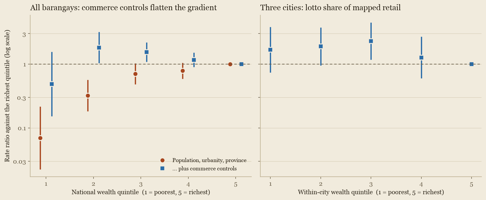
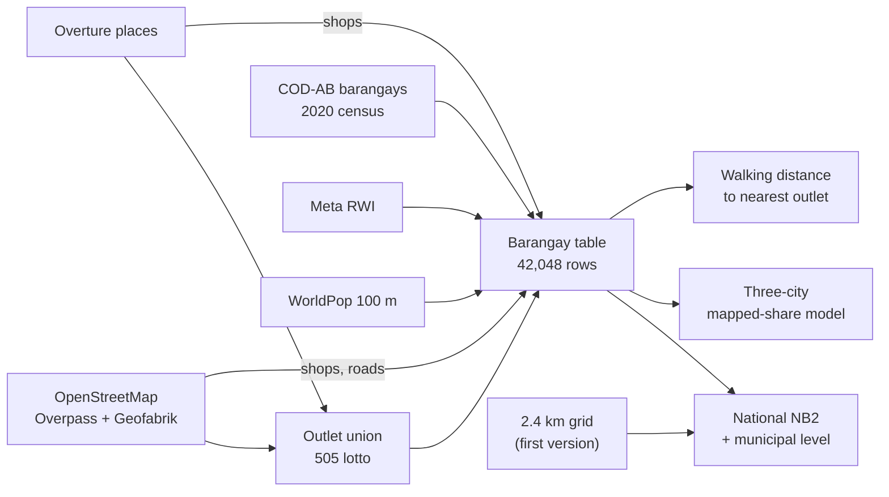

# Lottery as a tax on the poor? A spatial test for the Philippines

Earl Yu.
Second version, 29 October 2026.
Open data only.
Lotto outlets from OpenStreetMap (pulled 23 October 2026) and Overture Maps (release 2026-10-21.0); shops, food and roads from OpenStreetMap (snapshot 28 October 2026).

**Abstract.**
Are lotto outlets in the Philippines concentrated in poorer neighbourhoods?
On the best open data, no, and the question cannot yet be answered properly without the PCSO's own outlet list.
Open sources hold 505 lotto outlets, about 11% of the roughly 4,600 the Philippine Charity Sweepstakes Office (PCSO) authorises, and the missing ones are concentrated in poorer, less-mapped places.
This version rebuilds the study along the methods of the peer-reviewed literature: barangays as the unit, 2020 census population, a negative-binomial count model with an estimated dispersion, controls for urbanity and for commerce, province fixed effects and a check for spatial dependence.
Because the outcome is incomplete, the headline design is restricted to the three best-mapped city areas (Metro Manila, Metro Cebu and Davao City) and models lotto outlets as a share of all mapped shops, so that mapping effort largely cancels out.
In those cities the poorest fifth of barangays has, if anything, a slightly larger lotto share of mapped retail than the richest fifth (rate ratio 1.67, 95% CI 0.74-3.80), and the clearest difference is a higher share in the middle fifth (2.29, 1.17-4.48).
Nationally, the strong "richer places have more outlets" gradient of the first version mostly disappears once mapped commerce is controlled for: the poorest fifth's rate ratio moves from 0.07 to 0.49 (0.15-1.56), and about 73% of that gradient is accounted for by commerce.
Inside Metro Manila, poorer neighbourhoods live slightly closer to a mapped outlet than richer ones (median walk 1.5 km against 2.2 km).
This matches the lottery-specific literature, where outlets follow ordinary convenience retail and show weak or null income gradients, unlike gaming machines and betting shops.
The study measures where tickets are sold, not who buys them, so it says nothing directly about the spending claim at the heart of "a tax on the poor".



*Figure 1. Rate ratios against the richest wealth quintile, with 95% intervals, on a log scale. Left: lotto outlets per person across all barangays, with and without the commerce controls. Right: the headline design, lotto outlets as a share of mapped retail in the three best-mapped city areas.*

## Contents

1. [Background and objectives](#1-background-and-objectives)
2. [Research questions](#2-research-questions)
3. [What the literature does](#3-what-the-literature-does)
4. [Data](#4-data)
5. [Method](#5-method)
6. [Results](#6-results)
7. [Discussion](#7-discussion)
8. [Limitations](#8-limitations)
9. [Next steps](#9-next-steps)
10. [References](#references)
11. [How to reproduce](#how-to-reproduce)

## 1. Background and objectives

This project started with Johnny Harris's video [*The US Lottery is a Lie*](https://www.youtube.com/watch?v=3Yn_3HqfV1w) (YouTube, 8 March 2023) [17].
It asks why US state governments run lotteries and where the money comes from, and makes the case that lottery revenue leans on lower-income players.
That is the familiar charge that the lottery is "a tax on the poor".
This paper asks whether the same story can be seen on a map of the Philippines, using only data anyone can download.

The Philippine lottery is a state enterprise, and a large one.
The PCSO runs Lotto, the Small Town Lottery (STL) and the sweepstakes.

| Measure | Value | Source |
|---|---|---|
| PCSO gaming revenue, 2023 | PHP 61.45 billion (about US$1.1 billion), up 7% on 2022 | Philstar [1] |
| PCSO gaming revenue, 2024 | PHP 62.35 billion, of which STL PHP 31.76 billion and Lotto with digit games PHP 29.72 billion | PCSO 2024 year-end report [2] |
| Price of a standard lotto play | PHP 20, rolled back from PHP 24 in 2020 | Philstar [3] |
| Authorised lotto outlets | about 4,600 (October 2023), plus a separate STL network | Philstar [4] |
| For scale | more lotto outlets than 7-Eleven stores (about 4,000) and about 3.5 times the number of Jollibee branches (about 1,300) | Inquirer [5], Statista [6] |

The outlet comparisons are approximate and move year to year.
Against the 109.6 million people in the WorldPop layer, 4,600 outlets is about 4.2 per 100,000 people, or one for every 24,000.
The terminals and draw system are leased from private firms: in 2021 a joint venture of Pacific Online Systems, Philippine Gaming Management Corporation and International Lottery & Totalizator Systems won a five-year, PHP 5.8 billion nationwide lease [7].

What sharpens the question is where the money goes, because that is set by statute.
The sweepstakes date back to Act No. 4130 of 1934, and the PCSO's charter is Republic Act 1169 of 1954 [8].
Section 6 of the charter, as amended by Batas Pambansa Blg. 42 in 1979, splits net receipts 55% to prizes, 30% to a charity fund for "health programs, medical assistance and services and/or charities of national character", and 15% to operations [9].
The Universal Health Care Act (Republic Act 11223, 2019) then directs 40% of that charity fund to PhilHealth [10].
In a single month the charity fund can cover tens of thousands of patients' medical bills [11].
The STL exists as a legal alternative to *jueteng*, the illegal numbers game penalised under Presidential Decree 1602 as amended by Republic Act 9287 [12].
So a PHP 20 bet funds hospital bills by law, and it matters whose PHP 20 it is.

"A tax on the poor" bundles two claims.
The **access claim** is that outlets are concentrated in poorer neighbourhoods, which a map can test.
The **spending claim** is that poorer households spend a larger share of income on tickets, which only household budget or sales data can test.

**Objective.**
Test the access claim with open data, using the methods of the peer-reviewed outlet-location literature, and be explicit about what the result can and cannot say, above all because the open outlet record is incomplete.

**What changed from the first version.**
The first version (23 October 2026) counted OpenStreetMap outlets on the 2.4 km grid of the wealth index and found a strong positive national gradient, with nothing clear inside Metro Manila.
A literature review of 23 verified studies [20] found that design right in kind but incomplete in three ways: the unit was not one where the wealth measure is native, there was no control for commerce, and nothing separated mapping effort from wealth.
This version fixes the first two and designs around the third; the grid results are kept as a robustness check ([6.5](#65-the-first-version-the-24-km-grid)).

## 2. Research questions

1. **RQ1 (headline).** In the best-mapped cities, is the lotto share of mapped retail higher in poorer barangays?
   This is the access claim in a form that mapping effort does not drive.
2. **RQ2.** Across all barangays, after accounting for population, urbanity and province, are lotto outlets more common per person in poorer barangays, and how much of any gradient does commerce account for?
3. **RQ3.** Do poorer residents live nearer an outlet?
4. **RQ4.** How far could the incompleteness of the open outlet record move the answers to RQ1 to RQ3?
5. **RQ5.** Are the answers robust to the spatial unit, the wealth measure, the model and the product (lotto against STL)?

## 3. What the literature does

The design follows a literature review commissioned for this version [20]; the studies it rests on are below.

**Outcome.**
Every peer-reviewed outlet-location study found uses a complete official register: a licensing database, a lottery agent list or council premises records [21-29].
None uses crowd-sourced points as the outcome.
Field checks are used to validate a register, not to build one [26, 28].

**Unit and exposure.**
The unit is the smallest census area on which the deprivation measure is native: census area units in New Zealand [21], dissemination areas in Montréal [22], tracts in New Jersey and the United States [24, 36], data zones in Glasgow [27], barrios in Madrid [29].
Deprivation is a census-based index in quantiles, occasionally a single income variable [29].

**Model.**
Outlets per head through a log-population offset in a Poisson or negative-binomial model [21, 37], with a presence (logistic) model alongside for the many zeros.
Spatial dependence is tested with Moran's I and handled with spatial error or lag models [29, 32, 36].
Access is measured as network distance or travel time from where people live to the nearest outlet [22, 31].

**What the evidence says.**
Gaming machines, video lottery terminals and betting shops sit disproportionately in deprived areas: in New Zealand (decile 10 against decile 1 rate ratio 15.1) [21], Montréal [22, 23], Great Britain [26], Glasgow [27], six UK cities [28] and Melbourne [30].
Lottery retailers are different.
In the only lottery-outlet density study before 2026, percent commercial land use was the strongest predictor and poverty ran the "wrong" way [24].
In Massachusetts, disadvantaged postcodes did not have more lottery agents, and unemployment went with fewer [25].
In Madrid, outlet counts, including the state lottery's points, fell with income, but with no commercial control [29].
Where it is measured, commerce or outlet density carries much of the deprivation effect; in Melbourne, gaming-machine density accounted for about 40% of the link between disadvantage and losses [32].

**The Philippines.**
No peer-reviewed lottery-outlet location study exists for the Philippines or, as far as the review found, any low- or middle-income Asian country.
The nearest Asian study is on pachinko parlours in Japan, and it is about access and behaviour, not where venues sit [35].

## 4. Data

All layers are public and need no account or API key, except the PSA poverty table, which needs a manual download ([4.3](#43-choosing-a-wealth-measure)).

| Layer | Source | Licence | Granularity | Vintage | Used for |
|---|---|---|---|---|---|
| Lotto outlets | OpenStreetMap via Overpass | ODbL 1.0 | Points | 23 Oct 2026 | Outcome |
| Lotto outlets | Overture Maps places [18] | CDLA Permissive 2.0 / Apache 2.0 | Points | Release 2026-10-21.0 | Outcome (union) |
| Barangay boundaries | OCHA COD-AB Philippines, v03, from NAMRIA and PSA [38] | CC BY-IGO | 42,048 barangays with PSGC codes | Valid from 13 Feb 2025 | Unit |
| Population, urban/rural | 2020 Census of Population and Housing by barangay (PSA), via OCHA Philippines [39] | CC BY | Barangay | 2020 | Offset, urbanity |
| Wealth | Meta / Data for Good Relative Wealth Index (RWI) [13] | CC BY-NC 4.0 | About 2.4 km grid | 2021 | Exposure |
| Population at 100 m | WorldPop 2020 UN-adjusted, constrained | CC BY 4.0 | 100 m raster | 2020 | Wealth weights, access origins |
| Population at 1 km | WorldPop 2020 UN-adjusted | CC BY 4.0 | 1 km raster | 2020 | Grid check |
| Shops, food, roads | OpenStreetMap, Geofabrik extract [40] | ODbL 1.0 | Points and lines | 28 Oct 2026 | Commerce controls, walking network |
| Shops, food | Overture Maps places [18] | CDLA Permissive 2.0 / Apache 2.0 | Points | Release 2026-10-21.0 | Commerce control |
| Poverty | PSA 2021 city and municipal poverty estimates [14] | Open, manual download | City or municipality | 2021 | Not run (see 4.3) |
| Boundaries | GADM 4.1 | Non-commercial | Province | 2022 | Grid check, maps |

### 4.1 The outlets

OpenStreetMap holds 602 lottery points after cleaning: 397 lotto outlets and 205 points named as Small Town Lottery, 176 of them in Davao region.
Overture holds 114 lotto outlets once PCSO offices, results pages, STL operator offices and name false positives are removed ([`src/outlets.py`](src/outlets.py), following the rules of the earlier Overture scout).
Only 6 of the 114 sit within 100 m of an OpenStreetMap outlet, so the **union holds 505 lotto outlets**, about 11% of the PCSO's 4,600.
STL is a different network, run by provincial franchise agents, so it is kept separate throughout, and only OpenStreetMap STL points are used; Overture's STL places are mostly operator offices.
The union is committed as [`data/derived/outlets_union.csv`](data/derived/outlets_union.csv) (source, product and coordinates only; Overture names can include personal names).

### 4.2 The outlet coverage gap

The open record is not a thin but even sample; its gaps follow wealth.

| Region | Share of people | Share of mapped lotto outlets | Lotto outlets per 100k | STL points | Mean RWI |
|---|---:|---:|---:|---:|---:|
| NCR (Metro Manila) | 12.0% | 20.7% | 0.64 | 1 | 1.31 |
| IV-A Calabarzon | 14.9% | 20.9% | 0.52 | 2 | 0.89 |
| III Central Luzon | 11.2% | 10.6% | 0.35 | 3 | 0.67 |
| VII Central Visayas | 7.8% | 14.4% | 0.68 | 1 | 0.54 |
| XI Davao | 5.2% | 6.8% | 0.49 | 176 | 0.47 |
| I Ilocos | 5.1% | 1.8% | 0.13 | 0 | 0.45 |
| X Northern Mindanao | 5.2% | 3.5% | 0.25 | 14 | 0.34 |
| VI Western Visayas | 7.4% | 4.0% | 0.20 | 1 | 0.31 |
| CAR | 1.8% | 1.5% | 0.32 | 0 | 0.28 |
| XIII Caraga | 2.6% | 1.8% | 0.26 | 0 | 0.21 |
| V Bicol | 6.0% | 1.8% | 0.11 | 0 | 0.19 |
| IX Zamboanga Peninsula | 3.6% | 1.8% | 0.18 | 1 | 0.18 |
| VIII Eastern Visayas | 4.2% | 8.8% | 0.78 | 1 | 0.17 |
| II Cagayan Valley | 3.5% | 0.3% | 0.03 | 0 | 0.14 |
| BARMM | 2.2% | 0.0% | 0.00 | 0 | 0.13 |
| XII Soccsksargen | 4.5% | 0.3% | 0.02 | 3 | 0.11 |
| Mimaropa | 2.9% | 1.3% | 0.16 | 2 | 0.06 |

OpenStreetMap lotto outlets only; regions sorted from richest to poorest by population-weighted RWI.
Source: [`data/derived/outlets_by_region.csv`](data/derived/outlets_by_region.csv), from [`src/coverage.py`](src/coverage.py).

Richer regions have more mapped lotto outlets per person (rank correlation across the 17 regions +0.67, p = 0.003).
Metro Manila and Calabarzon hold 27% of people and 42% of mapped lotto outlets; Cagayan Valley, Soccsksargen and BARMM hold 10% of people and 2 outlets between them.
Overture carries the same bias, slightly stronger, so adding it does not change the shape of the gap.
A more than 30-fold spread in mapped outlets per person between regions with any outlets at all is far more than retail geography would explain, so much of it is mapping effort.
That is why the headline design ([5.6](#56-the-mapping-effort-design-headline)) is built so that mapping effort cancels out.

### 4.3 Choosing a wealth measure

| Indicator | Measures | Finest open level | Used here |
|---|---|---|---|
| Meta RWI | Relative wealth, modelled from satellite, phone and connectivity data [13] | About 2.4 km grid | Yes, aggregated to barangays |
| PSA small-area estimates, 2021 [14] | Poverty incidence (%) with coefficients of variation | City or municipality | Coded, not run |
| Community-Based Monitoring System (RA 11315) [15] | Household poverty | Barangay | No, held by local governments |

A true barangay poverty rate exists but is not public.
The PSA's 2021 municipal poverty estimates are the right second-level exposure, but the PSA website answers scripted downloads with a Cloudflare bot check, so the pipeline cannot fetch them.
The code to use them is in place and was tested on a synthetic file; [`docs/psa-poverty-data.md`](docs/psa-poverty-data.md) gives the exact file and the one manual step.
Until then, the municipal level uses population-weighted RWI.

## 5. Method

### 5.1 Units

**Barangays** are the primary unit: 42,048 polygons with PSGC codes from the OCHA COD-AB boundaries.
Census population joins on PSGC code for 38,501 barangays and, where codes changed after 2020 (mostly Metro Manila and BARMM), on normalised municipality and barangay name for 3,370 more.
The 177 that match neither, mostly in BARMM's new Special Geographic Area, take their population from WorldPop instead.
**Cities and municipalities** (1,640 with people and wealth) are the second level, built by adding up barangays.
The **2.4 km grid** of the first version is kept only as a check on the unit (the modifiable areal unit problem).

### 5.2 Outcome

The count of lotto outlets in the OpenStreetMap plus Overture union per barangay, with log population as an offset, so every coefficient is a rate ratio per person.
A presence model (any outlet, logistic) runs alongside, as in [21, 37].

### 5.3 Exposure

Each barangay's wealth is the population-weighted mean RWI of the grid cells its people live in, weighting by WorldPop 100 m pixels.
For the 8,751 barangays with no populated pixel inside them (mostly small urban barangays), the grid cell under the barangay's interior point is used; 1,206 barangays (1% of people) fall outside the RWI grid and are dropped.
Barangays are cut into five **population-weighted quintiles**, each holding about 21.6 million people, and every rate ratio is against the richest quintile.
In the three-city design, quintiles are recomputed within those cities.

### 5.4 Controls

| Control | Measure | Why |
|---|---|---|
| Urbanity | PSA 2020 urban/rural flag of the barangay; log population density | Outlets are retail, and retail is urban [31, 29] |
| Commerce | Log of mapped retail and food points (OpenStreetMap shops plus food, drink, pharmacy and market amenities; Overture shopping plus food and drink) | Lottery terminals sit inside ordinary shops; commerce was the strongest predictor in [24] |
| Roads | Log OpenStreetMap road length (residential and above, plus service roads) | Second commerce and urban-form proxy |
| Province | Province fixed effects | Absorb PCSO branch differences and regional mapping effort |

Provinces with no outlet at all add nothing to a fixed-effects likelihood, so they are dropped: the national fixed-effects models use 32,265 barangays in 55 provinces, holding 86% of people.

### 5.5 Model

Negative-binomial (NB2) with the dispersion estimated by maximum likelihood, in three steps: crude (quintiles only), without commerce (quintiles, urbanity, province), and full (plus commerce and roads).
The share of the poorest quintile's log rate ratio that the commerce controls remove is reported as the analogue of the 40% figure in [32].
Moran's I is computed on the full model's Pearson residuals with a contiguity matrix (barangays within about 20 m of each other), with a 999-permutation test.
If it is significant, the model is refitted with an eigenvector spatial filter [41]: the 60 eigenvectors of the centred contiguity matrix with the largest Moran's I enter as covariates.

### 5.6 The mapping-effort design (headline)

While the outcome is open map data, the national comparison mixes real outlet density with mapping effort.
The design that gets around this, following the review's step 7, has two parts.

**Restrict to the best-mapped cities.**
Metro Manila (NCR), Metro Cebu (its 13 member cities and municipalities) and Davao City.

| Area | People | OSM retail points per 1,000 people | OSM road km per km² | Lotto outlets per 100k (union) | Share of the PCSO national average | OSM lotto per 100 OSM retail points |
|---|---:|---:|---:|---:|---:|---:|
| Metro Manila (NCR) | 13.5 million | 2.66 | 21.2 | 0.88 | 21% | 0.23 |
| Metro Cebu | 3.2 million | 1.88 | 5.3 | 0.28 | 7% | 0.10 |
| Davao City | 1.8 million | 4.03 | 2.7 | 1.13 | 27% | 0.25 |
| Rest of the country | 90.4 million | 1.26 | 1.2 | 0.39 | 9% | 0.25 |

Source: [`data/derived/cities_mapping.csv`](data/derived/cities_mapping.csv).

"Best mapped" is relative.
Even Davao City's mapped lotto density is about a quarter of the PCSO's national average of 4.2 per 100,000, and Metro Cebu's retail mapping is barely above the rest of the country, so a check without Metro Cebu is reported.
The last column is the useful one: lotto outlets are about 0.25 of every 100 mapped shops in NCR, Davao City and the rest of the country alike, which is what the share design assumes, that mappers record lotto outlets at roughly the same rate as other shops.

**Model the share, not the rate.**
A negative-binomial count of OpenStreetMap lotto outlets per barangay, with offset log(OpenStreetMap retail and food points), log population and log density as covariates, within-city wealth quintiles and city fixed effects.
This is the analogue of Gilliland and Ross's adoption rate [23]: of the shops that could host a terminal, how many do, by wealth.
If mappers record lotto outlets at about the same rate as other shops in an area, mapping effort cancels out of the ratio to first order.
Numerator and denominator come from the same source, OpenStreetMap, because the cancellation argument only holds within one mapping community; the union over OpenStreetMap plus Overture retail is a check.
The 1,654 barangays with at least one mapped shop (93% of the cities' people, and all 107 OpenStreetMap lotto outlets in them) enter the model.

**A proposed audit (TODO, not done).**
The review recommends checking the map against the ground, as [26] and [28] did for their registers.
[`data/derived/audit_sample.csv`](data/derived/audit_sample.csv) holds a seeded random sample of 30 barangays from the share sample, six per within-city wealth quintile, with empty columns for the audit.
The method: for each barangay, walk or page through Google Street View along every street, and count lotto outlets (PCSO signage or a terminal visible) and all shopfronts, with the imagery date.
The audit gives the mapped share of real lotto outlets and of real shops by wealth quintile, which tests the cancellation assumption directly.
**No audit has been carried out; the columns are empty and no counts in this paper come from one.**

### 5.7 Access

Following [22], each person's distance to the nearest lotto outlet is measured along the walking network: every OpenStreetMap way pedestrians can use, within each city area's bounding box plus 3 km.
People are WorldPop 100 m pixels inside the area's barangays, joined to their nearest network node; outlets join the network through a virtual source linked to each outlet's nearest node.
Distances are summarised by within-city wealth quintile, weighted by population.
This runs for the three city areas only; nationally, with 11% of outlets mapped, distances would mostly measure mapping gaps.
Even in the cities these are distances to the nearest *mapped* outlet, so they are upper bounds.

### 5.8 Robustness

- **Units:** the same crude model on 2.4 km grid cells, barangays and municipalities.
- **Wealth:** RWI deciles and a continuous RWI score; PSA municipal poverty once the file is supplied.
- **Model:** Poisson against NB; with and without commerce; the spatial filter.
- **Products:** OpenStreetMap lotto only; lotto plus STL; STL only outside Davao Region.
- **Completeness simulation:** how far missingness tied to mapping effort could move the national gradient.
  Mapping effort is a municipality's OpenStreetMap retail points per person.
  Detection is set proportional to effort, or to its square root, and scaled so that about 505 of 4,600 outlets are expected to be found.
  *Null runs* place 4,600 true outlets in proportion to population, with no wealth effect, thin them with that detection rate, and refit the model 100 times; the spread of rate ratios shows how big a spurious gradient mapping effort alone produces.
  *Correction runs* weight each observed outlet by one over its detection rate and refit.

### 5.9 Pipeline



| Step | Script | Writes |
|---|---|---|
| Download every layer | [`src/fetch_data.sh`](src/fetch_data.sh), [`src/fetch_overture.py`](src/fetch_overture.py) | `data/raw/` (gitignored) |
| First version on the 2.4 km grid | [`src/analysis.py`](src/analysis.py), [`src/robustness.py`](src/robustness.py), [`src/coverage.py`](src/coverage.py) | [`data/derived/`](data/derived/) decile, NCR and region tables |
| Shops, food and roads from OpenStreetMap | [`src/osm_extract.py`](src/osm_extract.py) | `data/work/` |
| Outlet union with Overture | [`src/outlets.py`](src/outlets.py) | `outlets_union.csv`, `outlets_union.json` |
| Barangay table | [`src/barangays.py`](src/barangays.py) | `barangays_summary.json`, `data/work/barangays.parquet` |
| National and municipal models, robustness, simulation | [`src/barangay_models.py`](src/barangay_models.py), [`src/countmodels.py`](src/countmodels.py) | `national_models.json`, `national_quintiles.csv` |
| Three-city design and audit sample | [`src/cities.py`](src/cities.py) | `cities_*.json/csv`, `audit_sample.csv` |
| Access | [`src/access.py`](src/access.py) | `access.json`, `access_quintiles.csv` |
| Figures and maps | [`src/fig_models.py`](src/fig_models.py), [`src/viz.py`](src/viz.py), [`src/mapfig.py`](src/mapfig.py), [`src/map.py`](src/map.py) | [`figures/`](figures/), [`maps/`](maps/) |

## 6. Results

### 6.1 Headline: lotto share of mapped retail in the three cities (RQ1)

| Within-city wealth quintile | Barangays | People | Mapped shops | Mapped lotto outlets | Lotto per 100 mapped shops |
|---:|---:|---:|---:|---:|---:|
| 1 (poorest) | 554 | 3.66 million | 6,221 | 12 | 0.19 |
| 2 | 398 | 3.68 million | 13,219 | 29 | 0.22 |
| 3 | 450 | 3.69 million | 10,948 | 34 | 0.31 |
| 4 | 357 | 3.70 million | 9,053 | 18 | 0.20 |
| 5 (richest) | 480 | 3.69 million | 9,567 | 14 | 0.15 |

Source: [`data/derived/cities_quintiles.csv`](data/derived/cities_quintiles.csv) (OpenStreetMap shops and lotto outlets).

| Quintile, against the richest | Share model (headline) | Share, without Metro Cebu | Share, OSM + Overture | Per person, no commerce | Per person, with commerce |
|---|---:|---:|---:|---:|---:|
| 1 (poorest) | 1.67 (0.74-3.80) | 1.56 (0.66-3.70) | 1.69 (0.88-3.26) | 0.75 (0.35-1.62) | 1.49 (0.76-2.92) |
| 2 | 1.89 (0.95-3.75) | 1.91 (0.94-3.86) | 1.60 (0.90-2.83) | 1.69 (0.89-3.21) | 1.52 (0.86-2.70) |
| 3 | 2.29 (1.17-4.48) | 2.52 (1.28-4.99) | 1.99 (1.14-3.45) | 1.95 (1.04-3.66) | 1.86 (1.07-3.25) |
| 4 | 1.27 (0.60-2.69) | 1.39 (0.65-2.97) | 0.99 (0.53-1.88) | 0.77 (0.38-1.58) | 0.90 (0.48-1.71) |

Rate ratios with 95% intervals; NB2, dispersion 0.65 for the headline model.
Source: [`data/derived/cities_models.json`](data/derived/cities_models.json).

In the best-mapped cities, there is no sign that lotto outlets are a larger share of the shops in rich barangays, and no clear sign of the reverse either.
Every poorer quintile's point estimate is at or above the richest's, but only the middle quintile's interval clears 1: its shops are about twice as likely as the richest quintile's to be lotto outlets.
The middle-quintile peak, and the absence of any rich-barangay advantage, hold without Metro Cebu, on the OpenStreetMap plus Overture union, and per person with the commerce controls.
Residual spatial dependence is negligible (Moran's I 0.007, permutation p = 0.63), so no spatial refit was needed.

### 6.2 All barangays (RQ2)

| Quintile, against the richest | People per quintile | Lotto outlets | Outlets per 100k | Crude | Urbanity and province | Plus commerce (full) |
|---|---:|---:|---:|---:|---:|---:|
| 1 (poorest) | 21.6 million | 4 | 0.02 | 0.01 (0.01-0.04) | 0.07 (0.02-0.22) | 0.49 (0.15-1.56) |
| 2 | 21.6 million | 31 | 0.14 | 0.11 (0.07-0.16) | 0.32 (0.18-0.57) | 1.81 (1.03-3.18) |
| 3 | 21.6 million | 101 | 0.47 | 0.38 (0.28-0.50) | 0.70 (0.48-1.02) | 1.54 (1.09-2.18) |
| 4 | 21.6 million | 160 | 0.74 | 0.64 (0.48-0.84) | 0.79 (0.59-1.05) | 1.16 (0.90-1.51) |
| 5 (richest) | 21.6 million | 209 | 0.97 | 1 | 1 | 1 |

Rate ratios (95% intervals) from NB2 models; estimated dispersion 6.05 (crude), 3.43 (urbanity and province) and 1.06 (full).
Source: [`data/derived/national_quintiles.csv`](data/derived/national_quintiles.csv) and [`data/derived/national_models.json`](data/derived/national_models.json).

Without controls, the gradient is steep and runs the "wrong" way for the tax-on-the-poor story: the richest fifth of people has about 50 times the mapped-outlet rate of the poorest.
Urbanity and province fixed effects shrink it, and the commerce controls nearly remove it: the poorest quintile's rate ratio rises from 0.07 to 0.49, with an interval that includes 1, and the commerce controls account for about **73%** of its log rate ratio.
With commerce in, the second and third quintiles have more outlets per person than the richest (1.81 and 1.54), the same middle bulge as in the cities.
Commerce is by far the strongest predictor (rate ratio 8.4 per standard deviation of log mapped shops, 95% CI 7.0-10.1), in line with [24].
The poorest quintile holds only 4 mapped outlets, so its estimate is the least certain in the table.

The presence model agrees: with commerce in, the odds that a barangay has any outlet are higher in the second and third quintiles (3.13 and 1.89) than in the richest, and not distinguishable in the poorest (1.28, 0.34-4.87).
The residuals carry slight spatial dependence (Moran's I 0.012, p = 0.009); the eigenvector filter barely moves it (0.011) and leaves the rate ratios almost unchanged (poorest 0.45, 0.14-1.49).
The dependence is weak in size, but the intervals here should be read as slightly too narrow.

### 6.3 Access (RQ3)

| Within-city wealth quintile | Median walk, all three cities | Within 1 km, all three | Median walk, Metro Manila | Within 1 km, Metro Manila |
|---:|---:|---:|---:|---:|
| 1 (poorest) | 3.06 km | 13% | 1.52 km | 25% |
| 2 | 1.60 km | 27% | 1.44 km | 31% |
| 3 | 1.76 km | 25% | 1.55 km | 30% |
| 4 | 2.12 km | 17% | 1.96 km | 20% |
| 5 (richest) | 2.16 km | 21% | 2.18 km | 20% |

Walking distance to the nearest mapped lotto outlet (OpenStreetMap plus Overture), population-weighted.
Source: [`data/derived/access_quintiles.csv`](data/derived/access_quintiles.csv), which also has Metro Cebu and Davao City separately.

Inside Metro Manila, poorer residents live slightly closer to a mapped outlet than richer ones.
Across the three cities, the poorest quintile is furthest away, but that quintile is mostly the rural fringe of Davao City and Metro Cebu (median walks of 9.2 km and 8.2 km), where every kind of shop is far.
These are distances to mapped outlets: with perhaps a fifth to a quarter of outlets mapped even in these cities, real distances are much shorter, and if the missing outlets are spread like the mapped ones, the ranking by quintile would hold.

### 6.4 Robustness (RQ4 and RQ5)

**Completeness.**
Under the null that outlets follow population with no wealth effect, missingness proportional to mapping effort produces a spurious poorest-quintile rate ratio of about 0.53 (middle 95% of runs 0.29-0.92) without commerce controls, and 0.70 (0.36-1.17) with them; with detection proportional to the square root of effort, 0.70 (0.43-1.10) and 0.82 (0.43-1.38).
The observed 0.07 without commerce is far below anything this form of missingness produces on its own, so the uncontrolled national gradient is not only a mapping artefact; much of it is commerce.
The observed 0.49 with commerce sits inside the null range, so once commerce is controlled the remaining national gradient cannot be told apart from mapping effort.
Correcting the observed counts by inverse detection weights moves the poorest quintile's full-model rate ratio to 1.31 (0.29-5.84) or 4.56 (0.44-46.8), depending on the detection assumption: no evidence either way, with very wide intervals.
The simulation only models effort differences between municipalities, not within them, so it bounds the problem from below.

**Unit of analysis (crude NB2, the same outcome on each unit).**

| Unit | Units | Poorest quintile against richest | Per standard deviation of RWI |
|---|---:|---:|---:|
| 2.4 km grid cell | 40,170 | 0.01 (0.00-0.03) | 2.85 (2.47-3.29) |
| Barangay | 40,774 | 0.01 (0.01-0.04) | 3.44 (2.94-4.04) |
| City or municipality | 1,640 | 0.18 (0.09-0.35) | 1.74 (1.50-2.03) |

The crude gradient is steep on small units and flatter on municipalities, which average rich town centres with poor hinterlands.
At the municipal level, the controls behave as on barangays: the poorest quintile moves from 0.18 (crude) to 0.30 (0.09-1.02) with urbanity and province, and to 1.86 (0.55-6.28) with commerce.

**Wealth measure.**
On RWI deciles with all controls, the third to fifth deciles have the highest rates (fourth decile 2.07, 1.19-3.60, against the richest) and the bottom two the lowest point estimates (0.54 and 0.57, intervals 0.14-2.1), a hump rather than a slope.
A continuous RWI score gives 2.15 per standard deviation (1.66-2.77) without commerce and 0.87 (0.68-1.12) with it.
The PSA poverty comparison waits on the manual file ([4.3](#43-choosing-a-wealth-measure)).

**Model and product.**
Poisson gives the same picture as NB (poorest 0.42, second 1.70, third 1.38, with commerce).
OpenStreetMap lotto outlets alone (397) give poorest 0.35 (0.07-1.68) and second 2.12 (1.12-4.04); lotto plus STL (710 points) gives 0.83 (0.37-1.87) and 2.12 (1.27-3.53).
STL outside Davao Region has only 26 mapped points, too few to say anything.

### 6.5 The first version: the 2.4 km grid

The first version counted all 602 OpenStreetMap points on the RWI's own 2.4 km grid, with a negative-binomial dispersion fixed at 1.
Its results stand as a check on the unit and are reproduced unchanged by the same scripts.

| Model | Rate ratio per SD of wealth | 95% CI |
|---|---:|---:|
| National, wealth only | 2.20 | 2.01-2.41 |
| National, wealth and density | 3.19 | 2.78-3.65 |
| Inside Metro Manila, wealth only | 0.79 | 0.57-1.09 |

Source: [`data/derived/headline.json`](data/derived/headline.json) and [`data/derived/ncr_robustness.json`](data/derived/ncr_robustness.json).


*Figure 2. First version. Left: mapped outlets per 100,000 people by national wealth decile on the 2.4 km grid. Right: the same rate by wealth quintile inside Metro Manila; the dashed line is the Metro Manila average.*

The grid and barangay results agree on direction everywhere they overlap: a steep uncontrolled national gradient towards richer places, and no gradient inside the best-mapped cities.
What the barangay version adds is the explanation: the national gradient is mostly commerce, with the rest not distinguishable from mapping effort.


*Map 1. The national wealth grid (terracotta = poorer, teal = richer) with every OpenStreetMap lottery point, and Metro Manila. The interactive version is [`maps/lottery_map.html`](maps/lottery_map.html): download it and open it in a browser.*

## 7. Discussion

### 7.1 What the evidence shows

The access version of "a tax on the poor" predicts more outlets per person, or a larger share of shops selling lotto, in poorer neighbourhoods.
The open data show neither.
Where mapping is densest, the lotto share of shops is flat to slightly higher in poorer and middle-income barangays than in the richest, and poorer Metro Manila residents live slightly closer to an outlet; nationally, the steep "richer places have more outlets" pattern is mostly commerce.
The most consistent signal across designs is a middle-income bulge, with the second and third quintiles above the richest.

That is what the lottery-specific literature would predict.
Lotto terminals sit in sari-sari stores, supermarkets and mall kiosks, so lotto outlets follow ordinary retail, and ordinary retail follows people with money to spend.
The same weak or null income gradient appears in New Jersey [24] and Massachusetts [25].
Madrid is the counter-example, with more outlets in lower-income barrios, but it pools state-lottery points with betting shops and has no commerce control [29].
Lotto is a different product from gaming machines and betting shops, whose concentration in deprived areas is well documented [21, 26, 27, 28, 30].

### 7.2 Why outlet location is the wrong instrument for the spending claim

The claim most people mean is about wallets, not shopfronts: that poorer households spend a larger share of their income on tickets.
Outlet location cannot test that.
Where a kiosk sits is not where its buyers live, and a perfect count of outlets says nothing about how much each buyer spends relative to income.
The sales literature measures regressivity directly from sales or household spending [33, 34], and finds lottery spending regressive in most US settings.
So this study can reject a strong access claim for lotto, within the limits below, but it leaves the spending claim open.

## 8. Limitations

- **Outcome completeness, first and above all.** The open record holds about 11% of authorised lotto outlets, and its gaps follow wealth and region.
  The three-city share design is built so that mapping effort cancels out, but it rests on an assumption, that mappers record lotto outlets at the same rate as other shops, that only the audit (not done) or the PCSO list can test.
  Even the best-mapped city has about a quarter of the national average outlet density.
  STL, which takes more money than Lotto, is mapped almost only in Davao.
- **Commerce is partly mapped effort.** The commerce control counts mapped shops, so it carries mapping effort as well as real commerce.
  That is useful (it soaks up effort) but it means "73% explained by commerce" is "explained by mapped commerce", and some of that may be mapping.
- **Commerce may sit on the path.** If wealth draws shops and shops host terminals, controlling for shops removes part of a real wealth effect.
  The models with and without commerce bracket the answer; neither alone is "the" effect.
- **Small counts in the poorest quintile.** Four mapped outlets nationally, 12 in the cities.
  Every poorest-quintile interval is wide.
- **Province fixed effects drop 33 provinces** with no mapped outlet (14% of people); the national models describe the other 86%.
- **Spatial dependence** is slight but significant nationally and not removed by the spatial filter, so national intervals are a little too narrow.
  A full spatial model (BYM or ICAR) is a next step.
- **Wealth is modelled and relative.** The RWI is a 2021 modelled score on a 2.4 km grid, so neighbouring barangays inside one grid cell share a value; it is built partly from phone and connectivity data, which may also track commerce [13].
  The PSA poverty check is coded but needs the manual file.
- **Ecological fallacy.** The unit is the barangay, not the person; outlet location is not buyer residence.
- **Access distances** are to mapped outlets, so they are upper bounds, and they cover three city areas only.

## 9. Next steps

1. **File the PCSO eFOI request.** The draft, with fields, period, format and justification, is in [`docs/efoi-request-draft.md`](docs/efoi-request-draft.md).
   The full outlet list would let every model here run on a census instead of a sample.
2. **Run the Street View audit** on the 30 barangays in [`data/derived/audit_sample.csv`](data/derived/audit_sample.csv), to test the share design's assumption.
3. **Add the PSA municipal poverty estimates** by hand ([`docs/psa-poverty-data.md`](docs/psa-poverty-data.md)); the code is ready.
4. **Fit a full spatial model** (BYM or ICAR, for example in R-INLA) on the barangay graph.
5. **Extend access nationally** once the outcome is complete.
6. **Test the spending claim separately**, from PCSO sales by branch or province, or from Family Income and Expenditure Survey microdata if it itemises gambling, in the tradition of [34].

## References

1. Philstar. "PCSO earns P61.45 billion in 2023." 22 April 2024. <https://www.philstar.com/nation/2024/04/22/2349455/pcso-earns-p6145-billion-2023>
2. Philippine Charity Sweepstakes Office. *Accomplishment Report 2024, Year-end.* 26 February 2025. <https://pcso-gov.ph/pcsofiles/transparency/12/Accomplishment%20Report%202024%20Yearend%20(20250226).pdf>
3. Philstar. "PCSO rolls back lotto ticket price." 8 June 2020. <https://www.philstar.com/headlines/2020/06/08/2019414/headlines>
4. Philstar. "PCSO to push for more lotto outlets." 9 October 2023. <https://www.philstar.com/nation/2023/10/09/2302293/pcso-push-more-lotto-outlets>
5. Inquirer. "7-Eleven operator celebrates 4,000-store milestone in PH." <https://business.inquirer.net/485115/7-eleven-operator-celebrates-4000-store-milestone-in-ph>
6. Statista. "Number of Jollibee stores." <https://www.statista.com/statistics/1479196/number-of-jolibee-stores/>
7. BusinessWorld. "Pacific Online, partners bag lease for PCSO lottery system." 7 September 2021. <https://bworldonline.com/corporate/2021/09/07/394630/pacific-online-partners-bag-lease-for-pcso-lottery-system/>
8. Republic Act No. 1169 (1954), the PCSO Charter. LawPhil. <https://lawphil.net/statutes/repacts/ra1954/ra_1169_1954.html>
9. Batas Pambansa Blg. 42 (1979), amending RA 1169. LawPhil. <https://lawphil.net/statutes/bataspam/bp1979/bp_42_1979.html>
10. Republic Act No. 11223 (2019), Universal Health Care Act, Section 37(c). LawPhil. <https://lawphil.net/statutes/repacts/ra2019/ra_11223_2019.html>
11. GMA News. "PCSO: 37,186 patients benefit from medical assistance in May." <https://www.gmanetwork.com/news/money/companies/657405/pcso-37-186-patients-benefit-from-medical-assistance-in-may/story/>
12. Republic Act No. 9287 (2004), increasing penalties for illegal numbers games. Supreme Court E-Library. <https://elibrary.judiciary.gov.ph/thebookshelf/showdocs/2/1457>
13. Chi, G., Fang, H., Chatterjee, S. and Blumenstock, J. E. "Microestimates of wealth for all low- and middle-income countries." *PNAS* 119 (3), e2113658119, 2022. <https://doi.org/10.1073/pnas.2113658119>
14. Philippine Statistics Authority. "PSA releases the 2021 city and municipal level poverty estimates." <https://psa.gov.ph/statistics/poverty-sae>
15. Republic Act No. 11315 (2019), Community-Based Monitoring System Act. Official Gazette. <https://www.officialgazette.gov.ph/2019/04/17/republic-act-no-11315/>
16. eFOI Philippines. "List of lotto outlets in the Philippines as of December 31, 2023." <https://www.foi.gov.ph/requests/list-of-lotto-outlets-in-the-philippines-as-of-december-31-2023/>
17. Harris, J. *The US Lottery is a Lie.* YouTube, 8 March 2023. <https://www.youtube.com/watch?v=3Yn_3HqfV1w>
18. Overture Maps Foundation. "Places guide." <https://docs.overturemaps.org/guides/places>
19. Foursquare. "Foursquare Open Source Places." <https://opensource.foursquare.com/os-places/>
20. *Lottery outlets and area wealth: what the literature does, and how to redo the Philippine study.* Literature review for this project, 29 October 2026 (23 studies, each verified against Crossref or Europe PMC). Not published.
21. Wheeler, B. W., Rigby, J. E. and Huriwai, T. (2006). Pokies and poverty: problem gambling risk factor geography in New Zealand. *Health & Place* 12(1), 86-96. <https://doi.org/10.1016/j.healthplace.2004.10.011>
22. Robitaille, E. and Herjean, P. (2008). An analysis of the accessibility of video lottery terminals: the case of Montréal. *International Journal of Health Geographics* 7, 2. <https://doi.org/10.1186/1476-072X-7-2>
23. Gilliland, J. A. and Ross, N. A. (2005). Opportunities for video lottery terminal gambling in Montréal: an environmental analysis. *Canadian Journal of Public Health* 96(1), 55-59. <https://doi.org/10.1007/BF03404019>
24. Wiggins, L., Nower, L., Mayers, R. S. and Peterson, N. A. (2010). A geospatial statistical analysis of the density of lottery outlets within ethnically concentrated neighborhoods. *Journal of Community Psychology* 38(4), 486-496. <https://doi.org/10.1002/jcop.20376>
25. Pugh, K. E., Shirk, S. D. and Volberg, R. A. (2026). Individual and neighborhood risk and protective factors of at-risk and problem gambling: a spatial analysis using geographic information systems. *Journal of Gambling Studies* 42, 663-683. <https://doi.org/10.1007/s10899-026-10475-6>
26. Wardle, H., Keily, R., Astbury, G. and Reith, G. (2014). 'Risky places?': mapping gambling machine density and socio-economic deprivation. *Journal of Gambling Studies* 30(1), 201-212. <https://doi.org/10.1007/s10899-012-9349-2>
27. Macdonald, L., Olsen, J. R., Shortt, N. K. and Ellaway, A. (2018). Do 'environmental bads' such as alcohol, fast food, tobacco, and gambling outlets cluster and co-locate in more deprived areas in Glasgow City, Scotland? *Health & Place* 51, 224-231. <https://doi.org/10.1016/j.healthplace.2018.04.008>
28. Hall, T., Jones, P. and Nash-Williams, G. (2021). Closures, clusters and deprivation: the geographies of high street betting shops in the early twenty-first century. *Geography* 106(3), 128-135. <https://doi.org/10.1080/00167487.2021.1970927>
29. Pérez, L., Rodríguez, A. and Shmarev, A. (2022). Gambling outlets location in urban areas: a case study of Madrid. *Journal of Gambling Studies* 38, 1229-1242. <https://doi.org/10.1007/s10899-021-10094-3>
30. Marshall, D. and Baker, R. (2001). Clubs, spades, diamonds and disadvantage: the geography of electronic gaming machines in Melbourne. *Australian Geographical Studies* 39(1), 17-33. <https://doi.org/10.1111/1467-8470.00127>
31. Pearce, J., Mason, K., Hiscock, R. and Day, P. (2008). A national study of neighbourhood access to gambling opportunities and individual gambling behaviour. *Journal of Epidemiology and Community Health* 62(10), 862-868. <https://doi.org/10.1136/jech.2007.068114>
32. Rintoul, A. C., Livingstone, C., Mellor, A. P. and Jolley, D. (2013). Modelling vulnerability to gambling related harm: how disadvantage predicts gambling losses. *Addiction Research & Theory* 21(4), 329-338. <https://doi.org/10.3109/16066359.2012.727507>
33. Clotfelter, C. T. and Cook, P. J. (1987). Implicit taxation in lottery finance. *National Tax Journal* 40(4), 533-546. <https://doi.org/10.1086/NTJ41788693>
34. Price, D. I. and Novak, E. S. (1999). The tax incidence of three Texas lottery games: regressivity, race, and education. *National Tax Journal* 52(4), 741-751. <https://doi.org/10.1086/NTJ41789427>
35. Kato, H. and Goto, R. (2018). Geographical accessibility to gambling venues and pathological gambling: an econometric analysis of pachinko parlours in Japan. *International Gambling Studies* 18(1), 111-123. <https://doi.org/10.1080/14459795.2017.1383503>
36. Lee, J. G. L., Sun, D. L., Schleicher, N. M., Ribisl, K. M., Luke, D. A. and Henriksen, L. (2017). Inequalities in tobacco outlet density by race, ethnicity and socioeconomic status, 2012, USA: results from the ASPiRE Study. *Journal of Epidemiology and Community Health* 71(5), 487-492. <https://doi.org/10.1136/jech-2016-208475>
37. Kephart, L. L., Rees, V. W., Giovenco, D. P. and Subramanian, S. V. (2025). The unequal geography of recreational cannabis retailers in the U.S. *American Journal of Preventive Medicine* 69(2), 107643. <https://doi.org/10.1016/j.amepre.2025.107643>
38. OCHA. "Philippines - Subnational Administrative Boundaries" (COD-AB). Humanitarian Data Exchange. <https://data.humdata.org/dataset/cod-ab-phl>
39. OCHA Philippines. "Philippines: Total Population by Barangay" (2020 Census). Humanitarian Data Exchange. <https://data.humdata.org/dataset/2020-census-total-population-by-barangay_admin4>
40. Geofabrik. "Philippines" OpenStreetMap extract. <https://download.geofabrik.de/asia/philippines.html>
41. Griffith, D. A. (2003). *Spatial Autocorrelation and Spatial Filtering: Gaining Understanding Through Theory and Scientific Visualization.* Springer. <https://doi.org/10.1007/978-3-540-24806-4>

Data: © OpenStreetMap contributors (ODbL); Overture Maps Foundation (CDLA Permissive 2.0 and Apache 2.0); Meta / Data for Good Relative Wealth Index via the Humanitarian Data Exchange (CC BY-NC 4.0); WorldPop, University of Southampton (CC BY 4.0); OCHA COD-AB and the PSA 2020 census via OCHA Philippines; GADM 4.1.

## How to reproduce

Needs Python 3.12, `curl`, about 1.1 GB of downloads and about 4 GB of memory.
Nothing is installed globally.

```bash
git clone https://github.com/earlcyu-petcircle/ph-lottery-outlets.git
cd ph-lottery-outlets
./run_all.sh              # venv, pinned packages, downloads, every analysis, figures, maps
./run_all.sh --refresh    # same, but pull fresh OpenStreetMap, Geofabrik and Overture data
```

Set `PYTHON=/path/to/python3.12` if `python3.12` is not on your path.
A run reuses anything already in `data/raw/`, so on the same downloads it reproduces the committed outputs exactly; a full run takes about four minutes once the data are downloaded.
OpenStreetMap and Geofabrik change daily, so a `--refresh` run will move the numbers slightly.
The optional PSA poverty file is a manual step: [`docs/psa-poverty-data.md`](docs/psa-poverty-data.md).
Step-by-step guides for rebuilding the first version's map by hand are in [`docs/qgis-guide.md`](docs/qgis-guide.md) and [`docs/python-webmap-guide.md`](docs/python-webmap-guide.md).

Code is MIT licensed (see [LICENSE](LICENSE)); the data keep their own licences, listed above.
