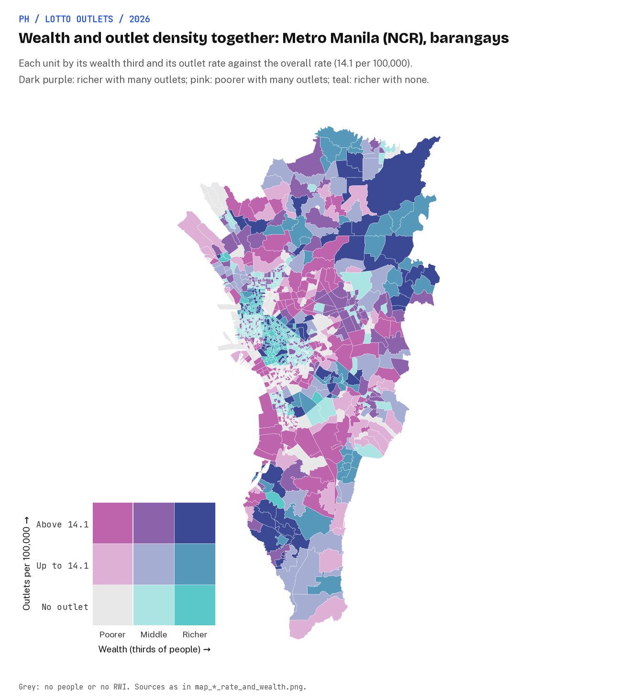

# Are Philippine lotto outlets concentrated in poorer or richer neighborhoods?

Earl Yu, November 2026.

**Lotto outlets follow commerce, not poverty. In Metro Manila, access is more equal.**
Lotto outlets are concentrated in richer areas, not poorer ones.
Richer places have more and closer outlets nationally, but that gap mostly reflects where commerce is.
But, in Metro Manila, that gap disappears: everyone lives near a lotto outlet and the lotto outlets per person are evenly distributed across wealth quintiles.

Read it as a one-page story with the interactive map at <https://earlcyu-petcircle.github.io/ph-lottery-outlets/>, or the [full paper](docs/paper.md).

## Where are lotto outlets concentrated?

The lottery is often dubbed as "a tax on the poor" since poorer households spend a far bigger share of their income on lotto tickets than richer ones.
There are two ways to test this: access and spend.
This study focuses on access: **are Philippine lotto outlets concentrated in poorer or richer neighbourhoods?**

## Three key insights

1. **Nationally, richer places have more lotto outlets per person, and the people there live closer to one:** 31x more outlets per 100,000 people in the wealthiest quintile (12.7) than the poorest one (0.4), and a median road distance of 11.5km against 0.6km.
2. **Outlets follow commerce, and that explains most of the rich-poor gap:** with urban share and shops held fixed, the wealth rate ratio falls from 2.45 to 1.17, a small lean towards richer places that holds through the spatial refits and outlet sensitivities (1.16 to 1.18).
3. **In Metro Manila, wealth makes no difference:** every wealth quintile has 12.5 to 15.2 outlets per 100,000 people and 99% live within 2km of the nearest lotto outlet.



## Data, methodology and limitations

Outlets are counted per 2.4 km tile of Meta's Relative Wealth Index and per barangay, compared per person by wealth quintile and with negative binomial count models, and measured by road distance; the [paper](docs/paper.md#4-research-design) has the full design.
Access is not spending, and every result is an association, not a cause; the paper's [limitations](docs/paper.md#8-limitations) set out the rest.
Outlets follow commerce, not poverty, so if the lottery is a tax on the poor in the Philippines, the case has to be made on spending, not on access.

## Where things are

| Path | What it holds |
|---|---|
| [`docs/index.html`](docs/index.html) | The story site, served by GitHub Pages from `docs/` |
| [`docs/map/`](docs/map/) | The interactive web map, embedded in the site and at `<site>/map/` |
| [`docs/paper.md`](docs/paper.md) | The full paper: background, design, results, discussion, limitations, references and appendices |
| [`docs/data-quality.md`](docs/data-quality.md) | How each source was parsed and joined, the column dictionary, and where the gaps sit |
| [`results/tables/`](results/tables/), [`results/figures/`](results/figures/) | Every model, rate and distance table, and the static maps and charts |
| [`data/derived/`](data/derived/) | The two analysis tables: one row per 2.4 km wealth tile (`tiles.csv`) and per barangay (`barangays.csv`) |
| [`notebooks/`](notebooks/), [`src/`](src/) | The five analysis notebooks and the pipeline code ([Appendix A](docs/paper.md#appendix-a-code-and-pipeline) of the paper) |

## How to reproduce

Needs Python 3.12, `curl`, [tippecanoe](https://github.com/felt/tippecanoe) for the web map (`brew install tippecanoe`), about 1.2 GB of downloads and 5 GB of memory.
Nothing else is installed globally.
The 2024 census workbooks cannot be downloaded by script: fetch the 18 files by hand into `data/manual/popcen2024/` first, as [`docs/data-quality.md`](docs/data-quality.md#getting-the-files) describes.

```bash
git clone https://github.com/earlcyu-petcircle/ph-lottery-outlets.git
cd ph-lottery-outlets
./run_all.sh              # every phase below, in order
./run_all.sh --refresh    # same, but pull fresh PCSO, OpenStreetMap and Overture snapshots

./01_collect_data.sh      # downloads into data/raw/ (reuses them unless --refresh)
./02_build_tables.sh      # tile and barangay tables in data/derived/
./03_analyse.sh           # runs the five notebooks: tables, charts and maps in results/
./04_build_map.sh         # web map tiles in docs/map/data/
.venv/bin/python src/04_build_map/serve_map.py   # the site at http://localhost:8000/, the map at /map/
```

Each phase checks that the outputs it reads exist and names the phase to run if they do not, so the analysis can be rerun without collecting the data again.
The phases share one small helper, `src/shared/setup.sh`, which makes the local virtual environment and checks for tippecanoe.
Set `PYTHON=/path/to/python3.12` if `python3.12` is not on your path.
A run reuses anything already in `data/raw/`, so on the same downloads it reproduces the committed tables byte for byte; the table build takes about 2 minutes and the analysis about 10 minutes.
A `--refresh` run picks up a newer PCSO map, OpenStreetMap and Overture, so expect the counts to move.

The web map reads PMTiles files by HTTP range requests, so neither it nor the site opens from `file://`; `serve_map.py` is a small range-aware server for `docs/`.
The story site is hand-written HTML with no build step, and its numbers are typed in from `results/tables/`, so a rerun that moves the tables needs the site updated by hand.
Its charts and map image load the PNGs in `results/figures/` from the `main` branch on GitHub, so a redrawn figure shows on the site once it is merged.
Outlet points appear only in a local build of the map: PCSO's outlet list is never committed.

GitHub Pages serves the site from the `main` branch and the `/docs` folder (Settings, Pages, Deploy from a branch).

## Licence

Code is MIT licensed (see [LICENSE](LICENSE)).
The data keep their own licences, listed in the paper's [data sources](docs/paper.md#3-data-sources) and references, and the committed tables, figures and map tiles are built from them.
The wealth values come from the Relative Wealth Index, which is CC BY-NC 4.0, so anything built on them is for non-commercial use with attribution.
