# Do poorer Filipinos have easier access to PCSO lottery outlets than richer Filipinos?

By: Earl Christian Yu
 Published on: 04 November 2026
 Last edited: 04 November 2026

*This is the full paper behind the one-page story site at <https://earlcyu-petcircle.github.io/ph-lottery-outlets/>, which carries the same results with an interactive map.*

## Summary

< to be finalized >

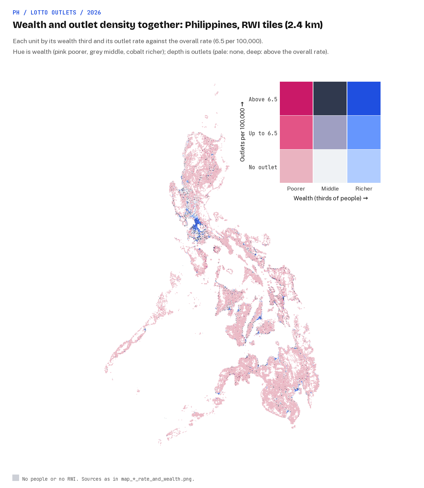

## Contents

1. [Background](#1-background)
2. [Research questions](#2-research-questions)
3. [Data sources](#3-data-sources)
4. [Research design](#4-research-design)
5. [Data](#5-data)
6. [Results](#6-results)
7. [Discussion](#7-discussion)
8. [Limitations](#8-limitations)
9. [Conclusion and future work](#9-conclusion-and-future-work)
10. [How to reproduce](#10-how-to-reproduce)
11. [References](#references)
12. [Appendix A. Code and pipeline](#appendix-a-code-and-pipeline)
13. [Appendix B. Every figure and table](#appendix-b-every-figure-and-table)
14. [Appendix C. Project history](#appendix-c-project-history)

## 1. Background

### 1.1 Inspiration

A few years ago, I came across [this YouTube video by Johnny Harris](https://www.youtube.com/watch?v=3Yn_3HqfV1w) [[1](#ref-1)] that shows why the US lottery is **"a tax on the poor"**. It is a way to tax people disguised as a fun game: you pay a small amount for a lotto ticket and get a chance to win a life-changing amount of money. In the US, poorer households spend as much as 33 times more on lotto tickets than richer households [[2](#ref-2)]. No wonder the lottery became known as a tax on the poor.

That got me thinking. **Is the Philippine lottery also a tax on poor Filipinos?** There are two ways to test this: **access and spend**. 
- **Access:** Are there more lotto outlets in poorer neighborhoods than richer ones?
- **Spend:** Do poorer households spend more on lotto tickets than richer households? 

The first question can be answered via spatial analysis and is the main scope of this paper. The second question, while also a crucial dimension, will not be part be part of this paper.

### 1.2 Philippine lottery

The Philippine Charity Sweepstakes Office (PCSO) is a government-owned and controlled corporation that runs the country's national and local lotteries. As of 2024, it recorded a revenue of PHP 62.35 billion [[3](#ref-3)]. It operates 7,443 outlets nationwide [[4](#ref-4)] - more than the number of 7-11 convenience stores (~4,000) [[5](#ref-5)] and Jollibee branches (~1,300) [[6](#ref-6)] in the country.

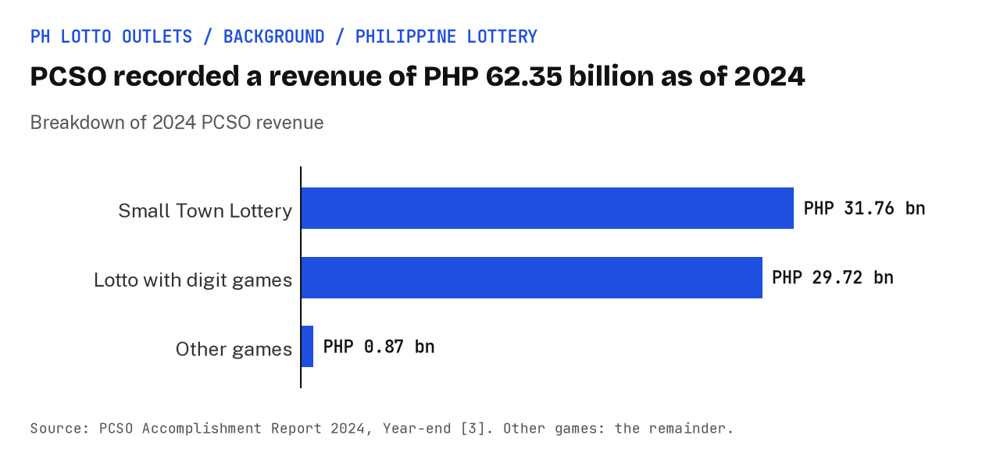

How the PCSO spends its money is dictated by law: 55% to prizes, 30% to a charity fund for "health programs, medical assistance and services, and/or charities of national character", and 15% to operations [[7](#ref-7)]. Moreover, the Universal Health Care Act (RA 11223) directs 40% of that charity fund to PhilHealth [[8](#ref-8)].

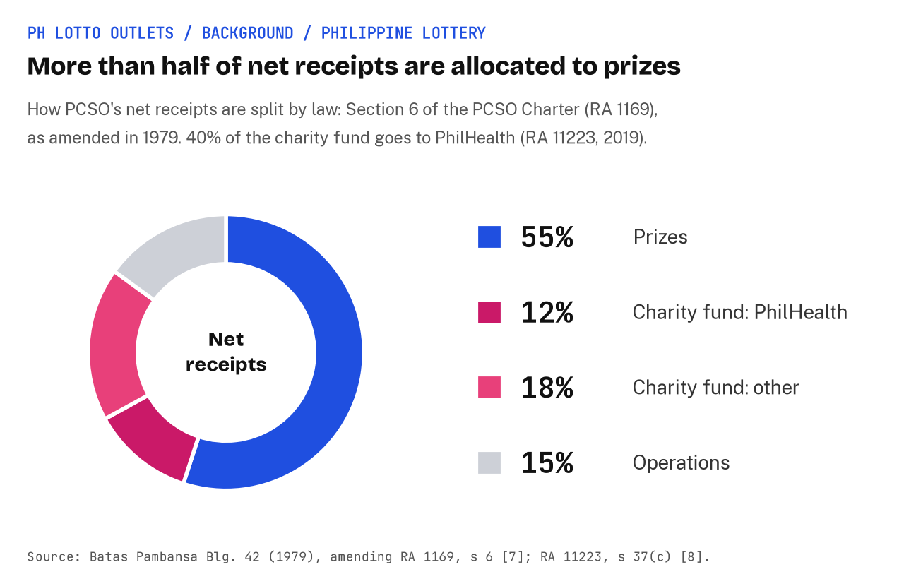

## 2. Research questions

1. **Outlets per person.** Are PCSO lotto outlets more or less common per person in poorer neighborhoods than in richer ones? Does the answer change once we account for province, how urban a place is, how many shops it has, and its road length?
3. **Within cities.** Does the rich-poor pattern persist in Metro Manila, Metro Cebu, and Metro Davao, where the poor and rich sit close together?
4. **Road distance.** How far do people in poor and rich neighbourhoods live from the nearest lotto outlet?

## 3. Data sources

### 3.1 Selected data sources

Every source is public and free to download. Why each data source was chosen is indicated in the table below:

| Data | Source | Grain | Year | Licence | Why this was chosen |
|---|---|---|---|---|---|
| Lotto outlets | PCSO "Traditional Lotto Outlets" map [[4](#ref-4)] | Point | Undated; pulled 2 Nov 2026 | Public PCSO publication | PCSO's own list, so it is complete by construction; 7,443 outlets against 6,494 agents at the end of 2023 |
| Wealth | Meta / Data for Good Relative Wealth Index (RWI) [[9](#ref-9)] | About 2.4 km tile, with a per-tile error | 2021 file | CC BY-NC 4.0 | The only open wealth measure finer than a city, so it can see rich and poor parts of the same city |
| Population count | PSA 2024 Census of Population, by barangay (downloaded by hand) | Barangay | 1 Jul 2024 | PSA publication | Official counts at the smallest administrative unit |
| Urban share | JRC GHSL Degree of Urbanisation | 1 km cell | 2025 epoch | CC BY 4.0 | A standard international urban definition, since the 2024 census carries no urban flag |
| Population pattern | WorldPop R2025A, constrained, 100 m | Pixel | 2024 | CC BY 4.0 | Spreads each barangay's census count to where its people live inside it |
| Boundaries and codes | OCHA COD-AB Philippines v03, PSGC codes | Barangay to region | Valid from Feb 2025 | CC BY-IGO | Official NAMRIA and PSA boundaries; 42,048 barangays |
| Shops | OpenStreetMap (Geofabrik) and Overture Maps places [[10](#ref-10)] | Point | Oct-Nov 2026 | ODbL; CDLA Permissive 2.0 and per-source terms | General shop counts for the commerce control; their own lotto points are left out |
| Roads | OpenStreetMap highways | Segment | Nov 2026 | ODbL | Road length as an urbanity control, and the network for RQ4 |

### 3.2 Unselected data sources

| Data | Source | Reason |
|---|---|---|
| Lotto outlets | OpenStreetMap | It only contains 397 lotto outlets, ~6% of PCSO's outlets. |
| Wealth | PSA city and municipal poverty estimates | Not granular enough; wealth varies a lot within cities, so a city-level measure would hide that nuance. |

## 4. Research design

| # | Research question | Data used | Methods used |
|---|---|---|---|
| RQ1 | Are PCSO lotto outlets more or less common per person in poorer neighborhoods than in richer ones? Does the answer change once we account for province, how urban a place is, how many shops it has, and its road length? | - PCSO lotto outlets counted per tile  - Meta Relative Wealth Index, per 2.4 km tile  - 2024 census population, spread onto tiles with WorldPop  - GHSL urban share  - Shop counts: OpenStreetMap and Overture  - Road distance: OpenStreetMap | - **Descriptive statistics:** count of outlets per 100,000 people by population-weighted wealth quintile  - **Regression model:** negative binomial regression and logistic regression  |
| RQ2 | Does the rich-poor pattern persist in Metro Manila, Metro Cebu, and Metro Davao, where the poor and rich sit close together? | - RQ1 data cut to each city  - official city boundaries | - same as RQ1 |
| RQ3 | How far do people in poor and rich neighbourhoods live from the nearest lotto outlet? | - OpenStreetMap road network  - population on WorldPop 100m pixels  - outlet points  - wealth quintiles | - **Road distance:** Dijkstra's algorithm  - **Descriptive statistics:** median road distance and share within 2km by wealth quintile, with straight-line distance alongside. |

### 4.1 Unit of analysis

The data come at various grains: lotto outlets are points, the wealth index is a 2.4km grid, and population is at a barangay-level. The design picks one unit and moves every layer onto it, which is the change-of-support problem [[11](#ref-11)].

| Unit chosen | Purpose | Notes |
|---|---|---|
| RWI tile (40,824 tiles, 40,737 with people) | For nationwide analysis | Wealth stays on its native grain.  Outlets are counted per tile.  Each barangay's census count is spread over its WorldPop 100 m pixels and summed per tile, which is dasymetric mapping [[12](#ref-12)]. |
| Barangay | For metro city comparisons | Population stays native, and wealth is the population-weighted RWI of the tiles its people live in.  In cities, several barangays share one tile's wealth value (Metro Manila's 1,711 barangays in the models have most of their people in 113 tiles), so standard errors are clustered by tile.

### 4.2 Descriptive statistics

A simple way to answer the core research question is calculate the number of lotto outlets per 100,000 people and compare that number among various wealth quintiles. The wealth quintiles are formed by categorizing the 40,824 RWI tiles into five groups, each with roughly the same population. Since poor areas are sparse and rural, the lowest quintile will likely consist of a lot of tiles while the top quintile will contain fewer tiles.

< insert image that illustrates the quintile process >

### 4.3 Negative binomial regression

A negative binomial regression model predicts the count of something and determines if a certain variable is a strong predictor of that count. This study applies the model to determine if wealth is a strong predictor of the count of lotto outlets per person in a given location. 

The model predicts the expected count through a log:

$$\log E[\text{outlets}_i] = \log(\text{pop}i) + \alpha{\text{province}} + \beta \cdot \frac{\text{RWI}_i}{0.49} + \gamma' x_i$$

- **The offset, log(population):** this term has its coefficient fixed at 1. It turns the model from “outlets” into “outlets per person”, so big tiles don’t win just by having more people.
- **The final answer is rate ratio:** how many times as many outlets per person a place one standard deviation richer has, with the other variables held constant. For example, if the final rate ratio is 2, that means that a place one standard deviation richer has 2x lotto outlets per person.
- **Adding controls:** Control variables can be included to prevent them from distorting the predictor's answer. For this study, the controls are urban share, province intercept, and count of shops. By including these variables, the model will only compare tiles that have the same control variables to ensure that the control variables are not the ones responsible for predicting the final count. 
- **Why negative binomial instead of Poisson:** Poisson assumes the variance equals the mean. Real counts are messier: lots of zeros, plus a few places with large clusters. Negative binomial adds a dispersion term, so the variance is μ + αμ². One way to picture it is that every place has its own hidden “appetite” for outlets beyond what the predictors explain. Poisson would ignore that extra spread and report confidence intervals that are too narrow.

### 4.4  Djikstra's algorithm

This algorithm is used to determine the shortest path using real roads to the nearest lotto outlet. People are placed on 100m population pixels. Each pixel and each outlet is snapped to the nearest road, then one search from all outlets at once gives every location its distance by road to the closest outlet.

### 4.5 Other models

- **Logistic regression:** This model predicts whether or not something is present. In this case, it can predict whether or not a tile contains a lotto outlet by calculating the probability that it contains one. Logistic regression was done to back up the results of the negative binomial regression model.
- **Spatial checks:** Moran's I on the residuals; where they cluster, a refit with Moran eigenvector spatial filters, a frequentist stand-in for a BYM2 spatial model [[13](#ref-13)].

### 4.6 What the research design can and cannot say

- The RWI is a modelled, relative score. It is not an income or a poverty rate, and its per-tile error is large next to differences inside a city.
- Shop mapping in OpenStreetMap and Overture is better in richer, more urban places, so the commerce control is itself uneven.
- Even a perfect outlet map says nothing about how much each household spends on lotto tickets. That entails a separate analysis.

## 5. Processed data

Two analysis-ready tables hold every input to the models, each row carrying PCSO outlets, people, wealth and its error, shop counts, road length, urban share, province, region and PCSO sales area.

| File name | Description |
|---|---|
| [`data/derived/tiles.csv`](../data/derived/tiles.csv) | One row per RWI tile (40,824), the main unit |
| [`data/derived/barangays.csv`](../data/derived/barangays.csv) | One row per barangay, the check |
| [`docs/data-quality.md`](data-quality.md) | How each source was parsed and joined, the column dictionary, and where the gaps sit. |

The data-quality headline:

- 7,284 of PCSO's 7,443 outlets (97.9%) are placed in a barangay, 133 more only at a town centre, and 26 (0.3%) cannot be placed.
- 331 GPS points disagree with the town in their address; they are kept and flagged.
- Population is the 2024 census: the 18 regional workbooks add up to the official 112,729,484 (with the 1,708 Filipinos counted at missions abroad), and 99.8% of barangays match a 2024 count by name.
- 99.4% of people live in a tile with an RWI value.
- BARMM is the weakest region for wealth (41 barangays without RWI) and has 15 outlets.

PCSO's outlet addresses can carry owners' names, so the outlet list itself is never committed; only counts per tile and per barangay are.

## 6. Results

Every ratio is per national standard deviation of the RWI (0.49 points), with a 95% interval in brackets.
A ratio above 1 means more outlets per person, or higher odds of any outlet, in richer places.
Quintiles split the people in each scope into five equal groups by wealth, from Q1 (poorest) to Q5 (richest).

### 6.1 RQ1: Outlets per person

> Are PCSO lotto outlets more or less common per person in poorer neighborhoods than in richer ones?
> Does the answer change once we account for province, how urban a place is, how many shops it has, and its road length?

#### 6.1.1 Descriptive statistics

- Outlets per 100,000 people rise at every step from Q1 to Q5: 0.4, 2.3, 6.7, 10.4 and 12.7 on tiles, against 6.5 across all tiles.
- Q5 has 30.9 times the outlets per person of Q1.
- On barangays the same rates are 0.4, 2.4, 6.4, 10.5 and 12.6.
- The share of people living in a tile with no outlet falls from 99.5% in Q1 to 91.4%, 59.5%, 23.2% and 5.5% in Q5.
- Shops per 1,000 people rise from 0.19 in Q1 to 0.74, 2.39, 4.54 and 5.74 in Q5.
- The share of people living in urban cells rises from 38% in Q1 to 75%, 93%, 99% and 99.8% in Q5.

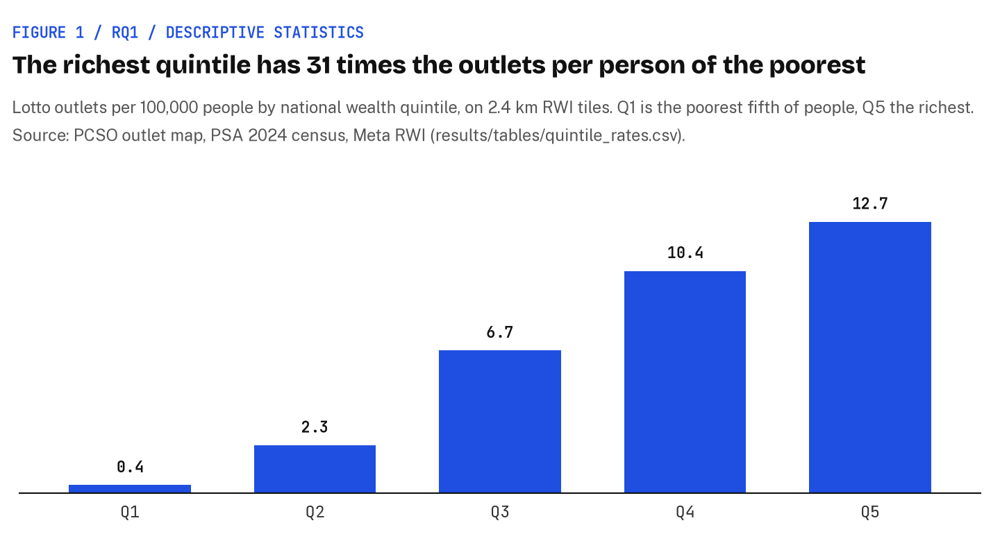

*Figure 1. Outlets per 100,000 people by national wealth quintile, on tiles. Source: [`quintile_rates.csv`](../results/tables/quintile_rates.csv).*

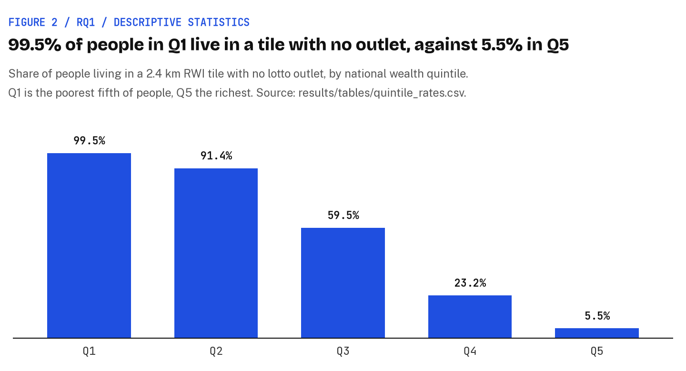

*Figure 2. Share of people living in a tile with no outlet, by national wealth quintile. Source: [`quintile_rates.csv`](../results/tables/quintile_rates.csv).*

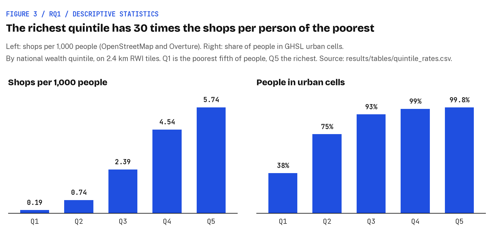

*Figure 3. Shops per 1,000 people and share of people in urban cells, by national wealth quintile. Source: [`quintile_rates.csv`](../results/tables/quintile_rates.csv).*

#### 6.1.2 Negative binomial regression

- Tiles (40,737 tiles, 7,271 outlets), with province intercepts in every step:
  - Wealth only: 2.45 (2.23-2.69).
  - \+ urban share: 2.13 (1.96-2.32).
  - \+ shops: 1.17 (1.07-1.29).
  - \+ shops and roads: 1.24 (1.13-1.36).
- Barangays (41,923 barangays, 7,282 outlets), same steps: 2.82 (2.67-2.98), 2.36 (2.22-2.52), 1.50 (1.39-1.61) and 1.22 (1.14-1.30).
- Every interval is above 1.
- The dispersion term α on tiles is 0.53, 0.49, 0.27 and 0.26 across the four steps.

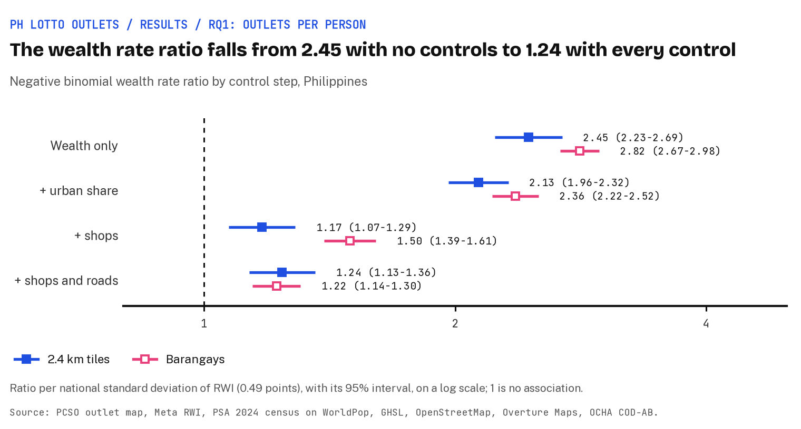

*Figure 4. Negative binomial wealth rate ratio by control step, tiles and barangays. Source: [`models.csv`](../results/tables/models.csv).*

#### 6.1.3 Logistic regression

- Tiles (40,240 tiles, 2,330 with an outlet): 2.18 (1.92-2.46) with urban share and 1.59 (1.38-1.84) with shops.
- Barangays (41,489 barangays, 3,884 with an outlet): 2.63 (2.47-2.81) with urban share and 1.41 (1.32-1.51) with shops.
- 497 tiles and 434 barangays are left out because every unit in their province has the same outcome.

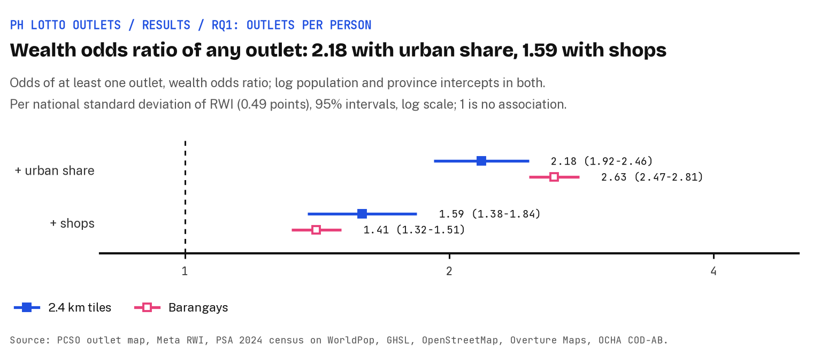

*Figure 5. Logistic wealth odds ratio of at least one outlet, tiles and barangays. Source: [`models.csv`](../results/tables/models.csv).*

#### 6.1.4 Spatial checks and outlet sensitivities

- Moran's I on the tile count models' residuals is -0.012 with urban share and 0.002 with shops, and -0.013 and 0.001 after a refit with 10 Moran eigenvectors.
- On barangays it is 0.039 and 0.042, and 0.034 and 0.037 after a refit with 100 eigenvectors.
- Spatial refit ratios: tiles 2.14 (1.97-2.32) with urban share and 1.18 (1.07-1.29) with shops; barangays 2.42 (2.27-2.57) and 1.51 (1.40-1.62).
- Only the 6,700 outlets whose GPS point matches their address: 2.12 (1.94-2.32) with urban share and 1.16 (1.05-1.27) with shops.
- Adding the outlets placed only at a town centre (7,399 outlets): 2.11 (1.95-2.29) and 1.17 (1.07-1.27).

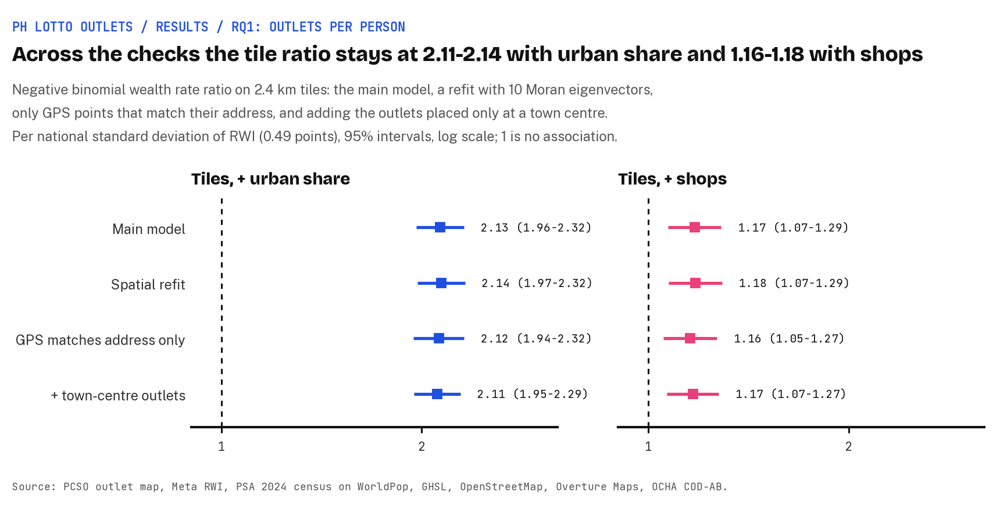

*Figure 6. Tile wealth rate ratio in the main model, the spatial refit and two outlet sensitivities. Source: [`models.csv`](../results/tables/models.csv), [`spatial_checks.csv`](../results/tables/spatial_checks.csv).*

### 6.2 RQ2: Within cities

> Does the rich-poor pattern persist in Metro Manila, Metro Cebu, and Metro Davao, where the poor and rich sit close together?

Each city's barangays are split into quintiles by the city's own people, not the country's.

#### 6.2.1 Descriptive statistics

- Outlets per 100,000 people, Q1 to Q5:
  - Metro Manila: 15.2, 12.5, 14.9, 14.0 and 14.1 (14.1 across the city).
  - Metro Cebu: 1.4, 5.2, 9.5, 12.8 and 8.4 (7.5).
  - Metro Davao: 0.1, 2.2, 4.6, 7.5 and 12.7 (5.5); its Q1 has one outlet for about 687,000 people.
- Shops per 1,000 people, Q1 to Q5:
  - Metro Manila: 7.5, 6.2, 5.3, 6.1 and 5.1.
  - Metro Cebu: 0.8, 2.2, 4.6, 8.1 and 5.3.
  - Metro Davao: 0.7, 1.6, 3.6, 7.7 and 8.0.

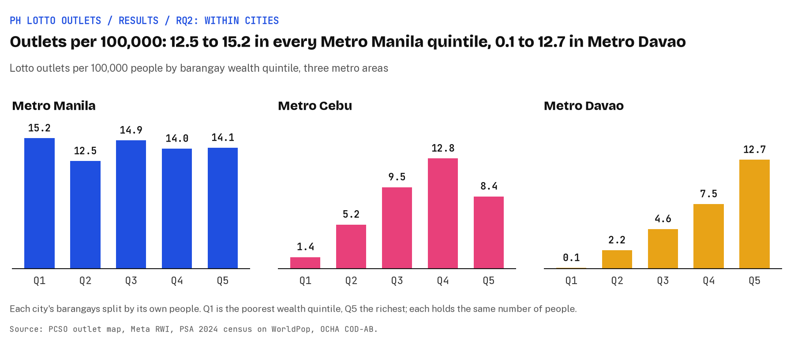

*Figure 7. Outlets per 100,000 people by each city's barangay wealth quintile. Source: [`quintile_rates.csv`](../results/tables/quintile_rates.csv).*

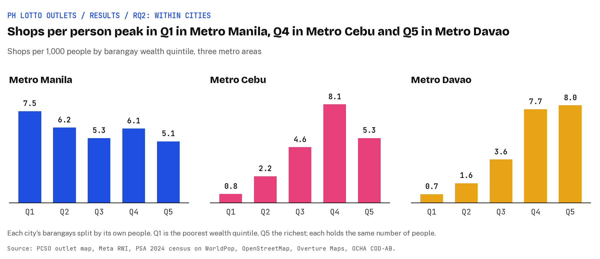

*Figure 8. Shops per 1,000 people by each city's barangay wealth quintile. Source: [`quintile_rates.csv`](../results/tables/quintile_rates.csv).*

#### 6.2.2 Negative binomial regression

- Barangays, with city and municipality intercepts and errors clustered by RWI tile, in the order wealth only, + urban share, + shops, + shops and roads:
  - Metro Manila (1,711 barangays, 1,979 outlets): 0.95 (0.82-1.09), 0.95 (0.82-1.09), 0.89 (0.75-1.04) and 0.93 (0.83-1.06).
  - Metro Cebu (348 barangays, 239 outlets): 3.33 (2.09-5.31), 2.34 (1.39-3.94), 1.23 (0.65-2.33) and 1.16 (0.72-1.89).
  - Metro Davao (548 barangays, 188 outlets): 4.65 (2.91-7.44), 4.55 (2.59-8.00), 3.47 (1.68-7.21) and 1.97 (1.20-3.21).
- Every Metro Manila interval includes 1, and every Metro Davao interval is above 1.
- Metro Cebu's intervals are above 1 for wealth only and + urban share, and include 1 for + shops and + shops and roads.

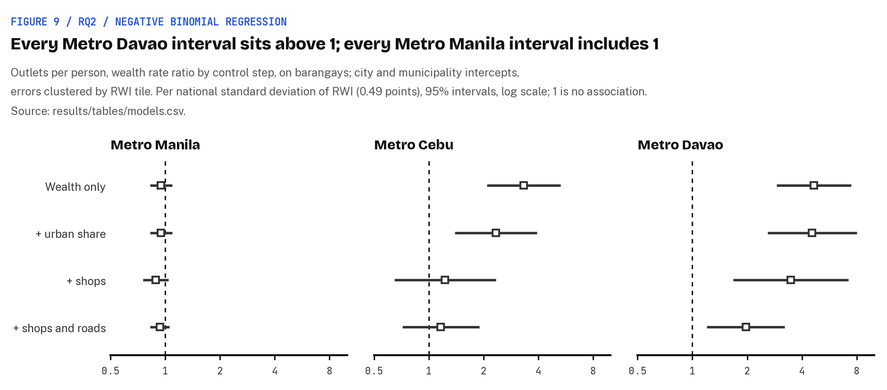

*Figure 9. Negative binomial wealth rate ratio by control step, on each city's barangays. Source: [`models.csv`](../results/tables/models.csv).*

#### 6.2.3 Logistic regression

- Barangays, + urban share and + shops:
  - Metro Manila: 1.20 (0.90-1.61) and 1.22 (0.85-1.77).
  - Metro Cebu: 3.51 (1.71-7.21) and 1.07 (0.43-2.63).
  - Metro Davao: 7.09 (3.71-13.56) and 3.35 (1.44-7.78).
- 9 Metro Manila and 54 Metro Davao barangays are left out because every barangay in their city or municipality has the same outcome.

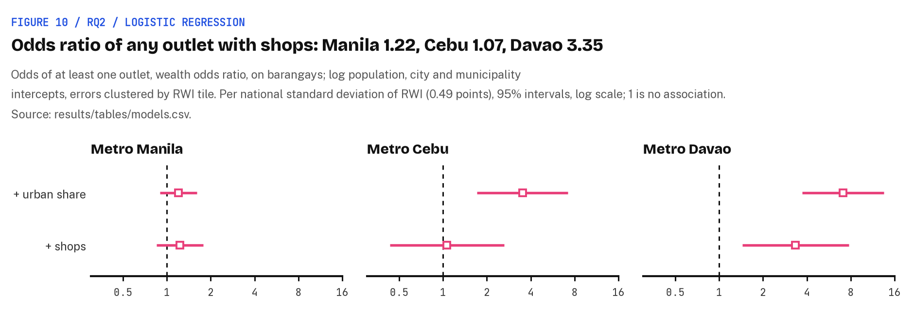

*Figure 10. Logistic wealth odds ratio of at least one outlet, on each city's barangays. Source: [`models.csv`](../results/tables/models.csv).*

#### 6.2.4 Tile models and spatial refits

- Tiles, in the order wealth only, + urban share, + shops, + shops and roads:
  - Metro Manila (121 tiles): 0.97, 0.95, 0.92 and 0.94, every interval including 1.
  - Metro Cebu (217 tiles): 2.36, 1.74, 0.91 and 0.95, the last two intervals including 1.
  - Metro Davao (913 tiles): 3.03, 2.69, 1.70 and 1.60, every interval above 1.
- Spatial refits: Metro Manila barangays 1.04 (0.88-1.24) with urban share and 0.92 (0.75-1.12) with shops; Metro Cebu barangays 2.29 (1.23-4.26) and 1.41 (0.75-2.64); Metro Davao tiles 1.64 (1.20-2.24) with shops.
- Moran's I on the barangay count models' residuals with shops is 0.047 in Metro Manila, 0.099 in Metro Cebu and 0.019 in Metro Davao; after the refit it is 0.023 in Metro Manila and -0.019 in Metro Cebu.

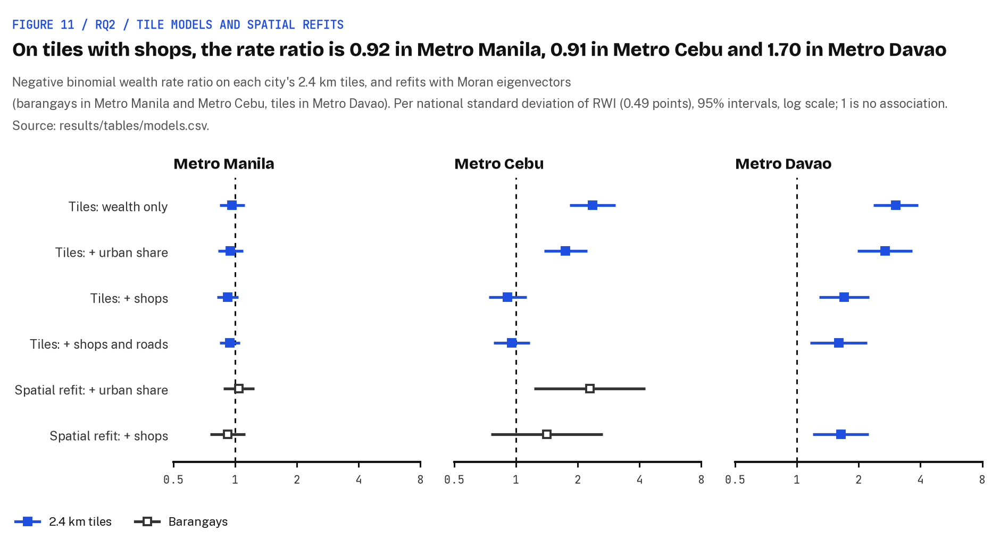

*Figure 11. Negative binomial wealth rate ratio on each city's tiles, and the spatial refits. Source: [`models.csv`](../results/tables/models.csv), [`spatial_checks.csv`](../results/tables/spatial_checks.csv).*

### 6.3 RQ3: Road distance

> How far do people in poor and rich neighbourhoods live from the nearest lotto outlet?

#### 6.3.1 Road distance

- Philippines, Q1 to Q5:
  - Median road distance to the nearest outlet: 11.5, 5.4, 2.1, 0.9 and 0.6 km (2.2 km overall).
  - Share of people within 2 km by road: 2%, 15%, 48%, 79% and 92%.
  - Share of people with no road route to any outlet: 4.4%, 2.8%, 0.7%, 0.2% and 0.04%.
- Median road distance by each city's own quintiles, Q1 to Q5:
  - Metro Manila: 0.4, 0.5, 0.4, 0.4 and 0.4 km, with 99% of people within 2 km in every quintile.
  - Metro Cebu: 4.5, 1.0, 0.7, 0.6 and 0.8 km.
  - Metro Davao: 12.5, 4.1, 1.6, 1.0 and 0.7 km.

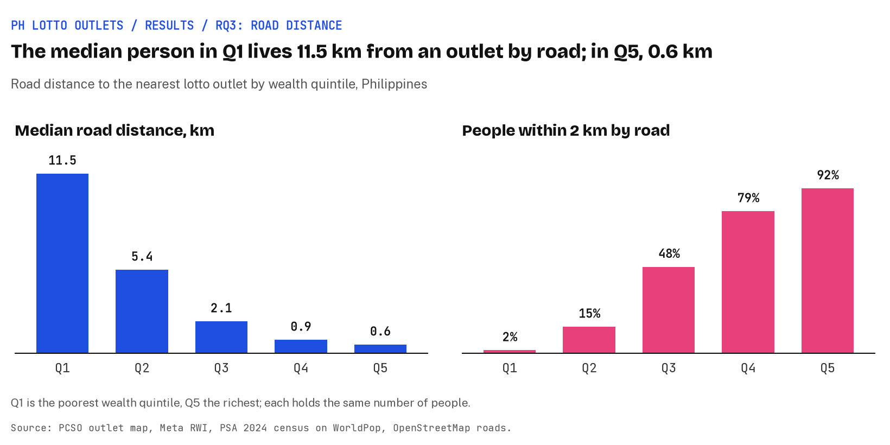

*Figure 12. Median road distance to the nearest outlet and share of people within 2 km by road, by national wealth quintile. Source: [`road_distance.csv`](../results/tables/road_distance.csv).*

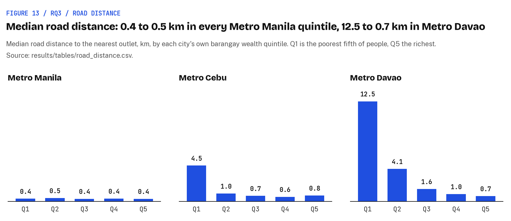

*Figure 13. Median road distance to the nearest outlet by each city's barangay wealth quintile. Source: [`road_distance.csv`](../results/tables/road_distance.csv).*

| Scope | Q1 | Q2 | Q3 | Q4 | Q5 |
|---|---:|---:|---:|---:|---:|
| Philippines | 11.5 km, 2% | 5.4 km, 15% | 2.1 km, 48% | 0.9 km, 79% | 0.6 km, 92% |
| Metro Manila | 0.4 km, 99% | 0.5 km, 99% | 0.4 km, 99% | 0.4 km, 99% | 0.4 km, 99% |
| Metro Cebu | 4.5 km, 24% | 1.0 km, 82% | 0.7 km, 97% | 0.6 km, 97% | 0.8 km, 96% |
| Metro Davao | 12.5 km, 1% | 4.1 km, 23% | 1.6 km, 62% | 1.0 km, 88% | 0.7 km, 95% |

*Table 1. Median road distance to the nearest outlet, and share of people within 2 km by road, by wealth quintile (national quintiles by tile, city quintiles by each city's barangays). Source: [`road_distance.csv`](../results/tables/road_distance.csv).*

#### 6.3.2 Straight-line distance

- Median straight-line distance to the nearest outlet, Philippines, Q1 to Q5: 7.9, 4.0, 1.5, 0.6 and 0.3 km.
- The straight-line median is shorter than the road median in every quintile.

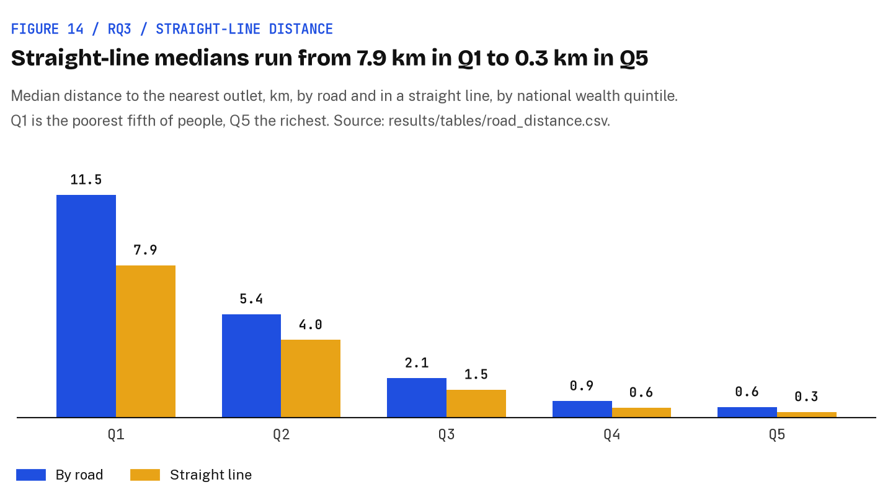

*Figure 14. Median distance to the nearest outlet by road and in a straight line, by national wealth quintile. Source: [`road_distance.csv`](../results/tables/road_distance.csv).*

## 7. Discussion

Lotto outlets follow shops and towns, not poverty: richer places have more and closer outlets nationally, but that gap mostly reflects where commerce is, and where everyone lives among shops, as in Metro Manila, it disappears.

### 7.1 Nationally, richer places have more outlets per person, and closer ones

- Outlets per 100,000 people rise at every step from 0.4 in Q1 to 12.7 in Q5, about 31 times as many (Figure 1).
- 99.5% of people in Q1 live in a tile with no outlet, against 5.5% in Q5 (Figure 2).
- The median person in Q1 lives 11.5 km from an outlet by road, against 0.6 km in Q5 (Figure 12, Table 1).
- Only 2% of people in Q1 live within 2 km of an outlet by road, against 92% in Q5.
- So on access, the national picture is the reverse of "a tax on the poor": the poorest Filipinos have the fewest outlets and the furthest to go.

### 7.2 In Metro Manila, wealth makes no difference

- Outlets per 100,000 people sit between 12.5 and 15.2 in every quintile (Figure 7).
  Q1 is highest at 15.2, but every Metro Manila model interval includes 1, so this is flat, not a lean towards the poor (Figure 9).
- The median road distance is 0.4 to 0.5 km in every quintile, with 99% of people within 2 km: an outlet within about 400 m for everyone, whatever their wealth (Figure 13, Table 1).
- Manila's barangays also span a narrow band of wealth (a standard deviation of 0.20 RWI points, against 0.49 nationally), so "flat" means no gradient within that band.
- Metro Davao repeats the national gradient: 0.1 outlets per 100,000 in Q1 against 12.7 in Q5, and a median of 12.5 km by road in Q1 against 0.7 km in Q5.
  Its boundary takes in Davao City's uplands, the southern municipalities and Samal as well as its urban core [[15](#ref-15)], so it holds a town and its hinterland in one region.
- Metro Cebu sits in between: its poorer interior is far from outlets (4.5 km in Q1), while Q2 to Q5 sit at 0.6 to 1.0 km.
  The [Metro Manila](../results/figures/map_ncr_bivariate.png), [Metro Cebu](../results/figures/map_cebu_bivariate.png) and [Metro Davao](../results/figures/map_davao_bivariate.png) maps show the difference at a glance.

### 7.3 Outlets follow commerce, and that explains most of the rich-poor gap

- A lotto terminal is a counter in a shop, a mall or a market, and in the Philippines shops cluster in towns, which are richer than the countryside around them: shops per 1,000 people rise from 0.19 in Q1 to 5.74 in Q5, and the urban share from 38% to 99.8% (Figure 3).
- The controls compare like with like: adding urban share and shops to the model asks whether, of two places in the same province with the same urban share and the same number of shops, the richer one still has more outlets per person.
- Nationally, the tile rate ratio falls from 2.45 with wealth only to 2.13 with urban share, 1.17 with shops and 1.24 with shops and roads (Figure 4), so most of the gap is a shops-and-towns gap.
- Like for like, richer places still have slightly more, and that holds through the spatial refits and outlet sensitivities (1.16 to 1.18 with shops; Figure 6), so there is no sign of outlets aimed at the poor.
- In the cities, Metro Cebu's gap disappears once shops are in (1.23, interval 0.65-2.33), while Metro Davao's shrinks but holds (3.47 with shops, 1.97 with shops and roads; Figure 9).
- This also explains Metro Manila: almost everyone lives in urban cells, and every quintile has 5.1 to 7.5 shops per 1,000 people, the most in Q1 (Figure 8), so outlets are close to everyone.

### 7.4 How this fits earlier studies

- Gaming machines and betting shops have been found to follow deprivation [[16](#ref-16), [17](#ref-17)].
- Lottery retail has not: in New Jersey commercial land use was the strongest correlate and poverty turned negative [[18](#ref-18)], and in Massachusetts disadvantaged postcodes had no more agents or sales [[19](#ref-19)].
- The Philippine result sits with the lottery studies: outlets go with commerce, and with commerce held fixed the residual lean is towards richer places.
  It adds a middle-income Asian case to a set of studies that had none.

## 8. Limitations

- **The wealth index's own error is not carried through the models.**
  The RWI is a modelled estimate with a per-tile error of 0.40 to 0.88 (mean 0.53), large next to Metro Manila's barangay standard deviation of 0.20 ([`docs/data-quality.md`](data-quality.md), notebook 3).
  The models treat it as exact, so their intervals are too narrow, most of all inside the cities, and error of this kind in a covariate tends to pull a ratio towards 1, which makes a flat result like Manila's weaker evidence than it looks.
  The RWI is also a 2021 relative score built partly from phone and connectivity data, not income or a poverty rate.
- **Shop coverage is uneven.**
  OpenStreetMap and Overture list 6.1 shops per 1,000 people in Metro Manila against 0.2 in BARMM and about 1.2 in Bicol and Soccsksargen, and both are better in richer, urban places ([`docs/data-quality.md`](data-quality.md)).
  The with-shops ratios rest on a control that is itself tied to wealth, and how far that biases them, and in which direction, is not known.
- **PCSO's outlet list is undated and may not be complete or current.**
  It lists 7,443 outlets against 6,494 agents at the end of 2023, more in every PCSO area, so it reads as a later list but may still hold closed outlets.
  The area figures for 2023 were read through a search index and not checked against the PDF (`pcso_cy2023_check.csv`).
  26 outlets could not be placed, 133 only at a town centre, and 331 GPS points disagree with their address; dropping or adding these moves the national ratios by 0.02 at most (`models.csv`).
- **2.4 km tiles are coarse inside cities.**
  Barangays in a city share wealth values (Metro Manila's 1,711 have most of their people in 113 tiles), so differences between neighbouring barangays inside one tile are invisible, and the errors are clustered by tile to allow for it.
  Barangay residuals cluster mildly nationally (Moran's I about 0.04; `spatial_checks.csv`); eigenvector refits leave the ratios where they were, but a full BYM2 model was not fitted.
- **The layers come from different years.**
  Outlets are a 2026 pull of an undated map, population is the 2024 census, wealth is a 2021 estimate, and shops and roads are October and November 2026.
  Outlets opened since 2024 in growing places would show there as more outlets per person.
- **Urban share cannot tell a town centre from a suburb**, since it is near 1 across the richer half of each city.
- **BARMM is thin**: 15 outlets for 5.7 million people and the weakest wealth coverage, so the national results say little about it.
- **Access is not spending.**
  Fewer outlets near poorer people does not mean poorer people buy fewer tickets: they may buy where they work, shop or travel, and the outlets in a commercial centre serve people who live elsewhere.
  Nothing here measures share of income either: a PHP 20 play is a larger share of a small income wherever it is bought, so the spending claim stays open and needs household budget data.
- **Association, not cause.**
  The ratios describe where outlets are relative to wealth, shops and towns; they do not say why PCSO and its agents put them there.
- **Lotto only.**
  The Small Town Lottery brought in PHP 31.76 billion of PCSO's PHP 62.35 billion gaming revenue in 2024 [[3](#ref-3)], and its booths are not published, so these results cover the lotto network, not PCSO gaming as a whole.

## 9. Conclusion and future work

On the open data, PCSO's lotto outlets are not concentrated in poorer Philippine neighbourhoods.
Nationally they are far denser per person in richer places, mostly in step with where shops and towns are, with a small lean towards richer places beyond that.
Inside Metro Manila wealth makes no difference to outlet density, inside Metro Davao richer barangays have more, and inside Metro Cebu the lean goes with shops.
The poorest Filipinos live furthest from an outlet.
If the lottery is a tax on the poor in the Philippines, the case has to be made on spending, not on access.

What would take this further:

- **Carry the RWI error through**, by refitting on draws of the RWI from its per-tile error or with an errors-in-variables model, so the intervals reflect how uncertain wealth is.
- **Test Metro Davao's urban core on its own**, to see whether its gradient is a town-and-hinterland contrast or holds among urban barangays too.
- **Fit a full BYM2 model** in place of the eigenvector refits.
- **Read PCSO's 2023 agent figures off the annual report PDF** to close the coverage check.
- **Validate the RWI against Community-Based Monitoring System barangay poverty** where a city shares it.
- **Map the Small Town Lottery** if PCSO or local governments publish its booths.
- **Test the spending claim** with household budget data on lotto spending by income, the only way to answer the other half of the question.

## 10. How to reproduce

The steps, requirements and local preview are in the repository's [README](../README.md#how-to-reproduce).
In short, `./run_all.sh` collects every source, builds the two tables, runs the five notebooks and builds the web map, and on the same downloads it reproduces the committed tables byte for byte.
PCSO's outlet list is never committed, so outlet points appear only on a local build of the map.

Code is MIT licensed (see [LICENSE](../LICENSE)).
The data keep their own licences, listed in section 3 and under References, and the committed tables, figures and map tiles are built from them.
The wealth values come from the RWI, which is CC BY-NC 4.0, so anything built on them is for non-commercial use with attribution.

## References

1. Harris, J. *The US Lottery is a Lie.* YouTube, 8 March 2023. <https://www.youtube.com/watch?v=3Yn_3HqfV1w>
2. Berger, C. "America's poorest households spend 33 times more of their income on lottery tickets than the rich, data shows." Fortune, 4 April 2024. <https://fortune.com/2024/04/04/lottery-tickets-poor-rich-income-powerball-mega-millions-jackpot-odds-les-bernal-stop-predatory-gambling/>
3. Philippine Charity Sweepstakes Office. *Accomplishment Report 2024, Year-end.* 26 February 2025. <https://pcso-gov.ph/pcsofiles/transparency/12/Accomplishment%20Report%202024%20Yearend%20(20250226).pdf>
4. Philippine Charity Sweepstakes Office. "Lotto Outlets" map. <https://www.pcso.gov.ph/Maps/Outlets.aspx>
5. Inquirer. "7-Eleven operator celebrates 4,000-store milestone in PH." <https://business.inquirer.net/485115/7-eleven-operator-celebrates-4000-store-milestone-in-ph>
6. Statista. "Number of Jollibee stores." <https://www.statista.com/statistics/1479196/number-of-jolibee-stores/>
7. Batas Pambansa Blg. 42 (1979), amending RA 1169. LawPhil. <https://lawphil.net/statutes/bataspam/bp1979/bp_42_1979.html>
8. Republic Act No. 11223 (2019), Universal Health Care Act, Section 37(c). LawPhil. <https://lawphil.net/statutes/repacts/ra2019/ra_11223_2019.html>
9. Chi, G., Fang, H., Chatterjee, S. and Blumenstock, J. E. "Microestimates of wealth for all low- and middle-income countries." *PNAS* 119 (3), e2113658119, 2022. <https://doi.org/10.1073/pnas.2113658119>
10. Overture Maps Foundation. "Places guide." <https://docs.overturemaps.org/guides/places>
11. Gotway, C. A. and Young, L. J. "Combining incompatible spatial data." *Journal of the American Statistical Association* 97 (458), 632-648, 2002. <https://doi.org/10.1198/016214502760047140>
12. Mennis, J. "Generating surface models of population using dasymetric mapping." *The Professional Geographer* 55 (1), 31-42, 2003. <https://doi.org/10.1111/0033-0124.10042>
13. Riebler, A., Sørbye, S. H., Simpson, D. and Rue, H. "An intuitive Bayesian spatial model for disease mapping that accounts for scaling." *Statistical Methods in Medical Research*, 2016. <https://doi.org/10.1177/0962280216660421>
14. JICA and Metro Cebu Development and Coordinating Board. *The Roadmap Study for Sustainable Urban Development in Metro Cebu*, final report, summary. June 2015. <https://openjicareport.jica.go.jp/pdf/12235529.pdf>
15. Republic Act No. 11708 (2022), Metropolitan Davao Development Authority Act, Section 4. LawPhil. <https://lawphil.net/statutes/repacts/ra2022/pdf/ra_11708_2022.pdf>
16. Wheeler, B. W., Rigby, J. E. and Huriwai, T. *Health & Place* 12 (1), 86-96, 2006. <https://doi.org/10.1016/j.healthplace.2004.10.011>
17. Raisamo, S., Toikka, A., Selin, J. and Heiskanen, M. *BMC Public Health* 19, 1198, 2019. <https://doi.org/10.1186/s12889-019-7535-1>
18. Wiggins, L., Nower, L., Mayers, R. S. and Peterson, N. A. *Journal of Community Psychology* 38 (4), 486-496, 2010. <https://doi.org/10.1002/jcop.20376>
19. Pugh, Shirk and Volberg. *Journal of Gambling Studies* 42 (2), 663-683, 2026. <https://doi.org/10.1007/s10899-026-10475-6>

Data: PCSO's published outlet map; Meta / Data for Good Relative Wealth Index via the Humanitarian Data Exchange (CC BY-NC 4.0); WorldPop, University of Southampton (CC BY 4.0); PSA 2024 Census of Population; JRC GHSL Degree of Urbanisation (CC BY 4.0); OCHA COD-AB Philippines (CC BY-IGO); © OpenStreetMap contributors (ODbL); Overture Maps places (CDLA Permissive 2.0 and per-source terms).

## Appendix A. Code and pipeline

The code sits in one folder per phase under [`src/`](../src/), named after the phase script at the repo root that runs it (section 10).
The analysis is five narrative notebooks in [`notebooks/`](../notebooks/), committed with their outputs so each table and chart sits beside a short reading of it; their logic lives as functions in [`src/03_analyse/`](../src/03_analyse/) (`outlet_rates.py`, `count_models.py`, `road_distance.py`, `pcso_cy2023.py`, `charts.py`, `maps.py`), which the notebooks import; `pcso_background.py` draws the two background charts in section 1 from figures typed in from their sources, and `results_figures.py` draws the numbered figures in section 6 from the committed tables.
Shared helpers are in [`src/shared/`](../src/shared/) (`common.py` paths and grid helpers, `analysis_samples.py` the analysis samples, `stats_tools.py` model and spatial helpers, `map_layers.py` the classes and colours the static and web maps share, `atlas.py` the story site's Atlas Grid style and its Riso data palette for every chart and map, with its fonts committed in `fonts/`, `palette_check.py` the palette's colour-blind checks, `run_notebook.py` the notebook runner `03_analyse.sh` uses, `setup.sh` the phase scripts' setup); each script adds that folder to Python's import path itself, so any script also runs on its own.

| Phase script | Step | Script | Writes |
|---|---|---|---|
| `01_collect_data.sh` | Download every source | [`download_sources.sh`](../src/01_collect_data/download_sources.sh), [`download_overture_places.py`](../src/01_collect_data/download_overture_places.py) | `data/raw/` (gitignored) |
| `02_build_tables.sh` | Read and check the 2024 census workbooks | [`read_census_2024.py`](../src/02_build_tables/read_census_2024.py) | `data/work/`, `data/derived/popcen2024_validation.json` |
| | Shop points and roads from OpenStreetMap | [`extract_osm_shops_and_roads.py`](../src/02_build_tables/extract_osm_shops_and_roads.py) | `data/work/` (gitignored) |
| | Barangays, 2024 census join, population and urban share on 100 m pixels, shops and roads per barangay | [`build_barangays.py`](../src/02_build_tables/build_barangays.py) | `data/work/`, `data/derived/barangays_summary.json` |
| | Parse PCSO GPS text, check it against the address, place outlets without coordinates | [`place_pcso_outlets.py`](../src/02_build_tables/place_pcso_outlets.py) | `data/work/` (outlet rows), `data/derived/pcso_geocoding.json` |
| | Tile and barangay tables, quality tables | [`build_tables.py`](../src/02_build_tables/build_tables.py) | `data/derived/` |
| `03_analyse.sh` | Outlets per 100,000 by wealth quintile, distributions, the PCSO CY2023 check | [`notebooks/01_descriptives.ipynb`](../notebooks/01_descriptives.ipynb) | `results/tables/`, `results/figures/` |
| | National count and presence models, spatial checks, sensitivities | [`notebooks/02_count_and_presence_models.ipynb`](../notebooks/02_count_and_presence_models.ipynb) | `data/work/` (model rows, residuals) |
| | Within cities: Metro Manila, Metro Cebu and Metro Davao, side by side with the national results | [`notebooks/03_within_cities.ipynb`](../notebooks/03_within_cities.ipynb) | `results/tables/`, `results/figures/` |
| | Road distance to the nearest outlet by wealth quintile | [`notebooks/04_road_distance.ipynb`](../notebooks/04_road_distance.ipynb) | `results/tables/` |
| | Static choropleth maps of outlet density beside wealth | [`notebooks/05_maps.ipynb`](../notebooks/05_maps.ipynb) | `results/figures/` |
| | The PCSO background charts (section 1) and the Results figures (section 6) | [`pcso_background.py`](../src/03_analyse/pcso_background.py), [`results_figures.py`](../src/03_analyse/results_figures.py) | `results/figures/` |
| `04_build_map.sh` | Web map vector tiles | [`build_map_tiles.py`](../src/04_build_map/build_map_tiles.py) | `docs/map/data/` |
| | Web map colours, from `map_layers.py` | [`write_web_palette.py`](../src/04_build_map/write_web_palette.py) | `docs/map/palette.js` |

## Appendix B. Every figure and table

The interactive web map in [`docs/map/`](map/) shows the same layers, and more, to zoom and click through, at <https://earlcyu-petcircle.github.io/ph-lottery-outlets/map/> or locally as the [README](../README.md#how-to-reproduce) describes.
The static figures in [`results/figures/`](../results/figures/) can be read without it:

| Figure | What it shows |
|---|---|
| [`map_national_bivariate.png`](../results/figures/map_national_bivariate.png) | Every 2.4 km wealth tile by wealth third and outlet rate together: the national relationship on one map |
| [`map_national_rate_and_wealth.png`](../results/figures/map_national_rate_and_wealth.png) | Outlets per 100,000 people beside the Relative Wealth Index, on the same tiles |
| [`map_ncr_bivariate.png`](../results/figures/map_ncr_bivariate.png), [`map_ncr_rate_and_wealth.png`](../results/figures/map_ncr_rate_and_wealth.png) | The same two maps for Metro Manila's barangays |
| [`map_cebu_bivariate.png`](../results/figures/map_cebu_bivariate.png), [`map_cebu_rate_and_wealth.png`](../results/figures/map_cebu_rate_and_wealth.png) | The same two maps for Metro Cebu's barangays |
| [`map_davao_bivariate.png`](../results/figures/map_davao_bivariate.png), [`map_davao_rate_and_wealth.png`](../results/figures/map_davao_rate_and_wealth.png) | The same two maps for Metro Davao's barangays |
| [`quintile_rates.png`](../results/figures/quintile_rates.png) | Outlets per 100,000 people by wealth quintile: national tiles against the barangays of the three cities, on one scale (notebooks 1 and 3) |
| [`rate_ratios.png`](../results/figures/rate_ratios.png) | The wealth rate ratio of every model variant, one panel each for the country and the three cities (notebook 3) |
| [`pcso_gaming_revenue_2024.png`](../results/figures/pcso_gaming_revenue_2024.png) | PCSO gaming revenue in 2024 by game (section 1) |
| [`pcso_net_receipts_split.png`](../results/figures/pcso_net_receipts_split.png) | The statutory split of PCSO's net receipts (section 1) |

The Results figures, in [`results/figures/`](../results/figures/) and drawn by [`results_figures.py`](../src/03_analyse/results_figures.py):

| Figure | File | What it shows |
|---|---|---|
| 1 | [`fig01_rq1_outlet_rate.png`](../results/figures/fig01_rq1_outlet_rate.png) | Outlets per 100,000 people by national wealth quintile |
| 2 | [`fig02_rq1_no_outlet.png`](../results/figures/fig02_rq1_no_outlet.png) | Share of people in a tile with no outlet, by national wealth quintile |
| 3 | [`fig03_rq1_shops_urban.png`](../results/figures/fig03_rq1_shops_urban.png) | Shops per 1,000 people and urban share, by national wealth quintile |
| 4 | [`fig04_rq1_count_model.png`](../results/figures/fig04_rq1_count_model.png) | National negative binomial wealth rate ratio by control step |
| 5 | [`fig05_rq1_presence_model.png`](../results/figures/fig05_rq1_presence_model.png) | National logistic wealth odds ratio of any outlet |
| 6 | [`fig06_rq1_checks.png`](../results/figures/fig06_rq1_checks.png) | National spatial refits and outlet sensitivities |
| 7 | [`fig07_rq2_outlet_rate.png`](../results/figures/fig07_rq2_outlet_rate.png) | Outlets per 100,000 people by each city's wealth quintile |
| 8 | [`fig08_rq2_shops.png`](../results/figures/fig08_rq2_shops.png) | Shops per 1,000 people by each city's wealth quintile |
| 9 | [`fig09_rq2_count_model.png`](../results/figures/fig09_rq2_count_model.png) | City negative binomial wealth rate ratio by control step, barangays |
| 10 | [`fig10_rq2_presence_model.png`](../results/figures/fig10_rq2_presence_model.png) | City logistic wealth odds ratio of any outlet, barangays |
| 11 | [`fig11_rq2_checks.png`](../results/figures/fig11_rq2_checks.png) | City tile models and spatial refits |
| 12 | [`fig12_rq3_road_national.png`](../results/figures/fig12_rq3_road_national.png) | Median road distance and share within 2 km, by national wealth quintile |
| 13 | [`fig13_rq3_road_cities.png`](../results/figures/fig13_rq3_road_cities.png) | Median road distance by each city's wealth quintile |
| 14 | [`fig14_rq3_straight_line.png`](../results/figures/fig14_rq3_straight_line.png) | Median road against straight-line distance, by national wealth quintile |

The tables in [`results/tables/`](../results/tables/):

| Table | What it holds |
|---|---|
| [`models.csv`](../results/tables/models.csv) | Every model's wealth rate ratio or odds ratio, interval, p-value and sample |
| [`coefficients.csv`](../results/tables/coefficients.csv) | Every coefficient of every model, controls included |
| [`spatial_checks.csv`](../results/tables/spatial_checks.csv) | Moran's I on each main model's residuals, before and after the spatial refits |
| [`quintile_rates.csv`](../results/tables/quintile_rates.csv) | Outlets, people, shops and urban share by wealth quintile, nationally and per city |
| [`distribution.csv`](../results/tables/distribution.csv) | Distributions of outlets, people, outlet rates, RWI and shops per tile and barangay |
| [`road_distance.csv`](../results/tables/road_distance.csv) | Road and straight-line distance to the nearest outlet by wealth quintile |
| [`pcso_cy2023_check.csv`](../results/tables/pcso_cy2023_check.csv) | PCSO's map against its CY2023 agent count, by PCSO area |

## Appendix C. Project history

The study was built in steps, each a pull request.
It began on 23 October 2026 as a first pass built on OpenStreetMap's lotto points ([#1](https://github.com/earlcyu-petcircle/ph-lottery-outlets/pull/1)), which hold only about 6% of PCSO's agents, so the design was redone around PCSO's own outlet map.
The final research design was settled on 31 October 2026 and shipped with the data collection ([#3](https://github.com/earlcyu-petcircle/ph-lottery-outlets/pull/3)).
The data analysis followed, first nationally and for Metro Manila ([#4](https://github.com/earlcyu-petcircle/ph-lottery-outlets/pull/4)), then for Metro Cebu and Metro Davao ([#5](https://github.com/earlcyu-petcircle/ph-lottery-outlets/pull/5)).
The results, discussion and clean-up came next, together, and turned the README into the finished paper ([#6](https://github.com/earlcyu-petcircle/ph-lottery-outlets/pull/6)).
Last came the one-page story site on GitHub Pages, at which point the paper moved from the README to this file.
